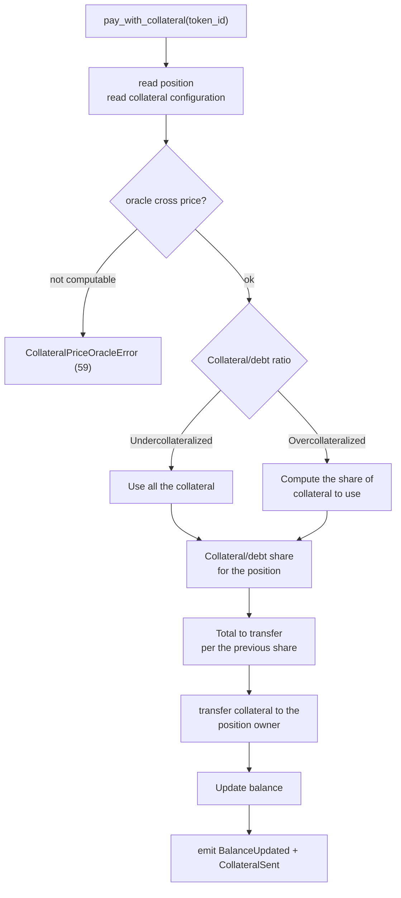

# Collateral

Equillar offers the option of using collateral to settle positions when the company cannot meet its payment obligations. It is a **per-position** safeguard, complementary and independent from the [emergency close](./emergency-close.md) gate.

## Adding collateral

Collateral is added through the function:

`add_collateral(collateral_token_addr, collateral_token_amount, collateral_token_symbol, collateral_addr)`

```bash
stellar contract invoke \
  --id <YOUR_CONTRACT_ID> \
  -s admin \
  --network testnet \
  -- \
  add_collateral \
  --collateral_token_addr "C...." \
  --collateral_token_amount "4000000000" \
  --collateral_token_symbol "ABC" \
  --collateral_addr "G..."
```

- **`collateral_token_addr`**: contract address of the token that will be used as collateral.
- **`collateral_token_amount`**: amount of collateral deposited, in units of `collateral_token_addr`.
- **`collateral_token_symbol`**: the token code.
- **`collateral_addr`**: the address that holds the collateral, from which funds are sent to the contract (the source must hold the `company` role).

The collateral contribution to the contract fails if any of these conditions is not met:

| Check | Error if violated |
|---|---|
| Contract is not paused | paused guard |
| Single collateral token: if collateral is already configured, the new deposit must use the **same** token | `OnlyOneCollateralTokenAllowed` (34) |
| The provider (`collateral_addr`) holds enough collateral-token balance | `AddressInsufficientBalance` (1) |
| The collateral level can be calculated against current obligations | `CollateralLevelNotComputable` (33) |
| The provider signs and the token transfer succeeds | Transfer errors |
| The total amount does not overflow | `CollateralAmountOverflow` (58) |

> **Ordering and no-op safety:** the collateral level is computed **before** the provider's tokens are transferred. If the level cannot be established (for example, due to an oracle failure when returning the price pair), the whole operation reverts cleanly, no tokens move and the balance is left untouched.

> The `CollateralLevelNotComputable` error does not express a minimum-level policy: it covers "the collateral level could not be computed" (the oracle pricing failed) — the current contract enforces being able to *compute* a level, not a minimum value for it.

## Calculating the collateral level

Collateral valuation depends on the `price_oracle` configured at deployment time (see [Deploying the contract](./deploying-the-contract.md)).

The contract calculates a **collateral level** (in basis points, ×100 — e.g. `6_000` = 60% coverage, `10_000` = 100%) as follows:

1. If there are no remaining payment obligations, the level is `10_000` (100%) by definition — no oracle call needed.
2. Fetch the collateral token's price and the contract token's price from the oracle, both expressed in the oracle's base asset at the oracle's decimal scale.
3. Compute the cross price: `collateral_price / contract_token_price`.
4. Convert the collateral amount into the contract-token denomination by multiplying it by the cross price (in fixed-point, checked arithmetic).
5. Scale: `level = collateral_value × 10_000 / payment_obligations`.

All arithmetic is WAD fixed-point and checked; a missing oracle price is **not** a trap — the operation returns a business error instead.

For the oracle to be compatible with Equillar, it must implement the following trait:

```rust
#[contracttype]
#[derive(Clone)]
pub enum Asset {
    Stellar(Address),
    Other(Symbol),
}

#[contracttype]
#[derive(Clone)]
pub struct PriceData {
    pub price: i128,
    pub timestamp: u64,
}

#[contractclient(name = "ReflectorClient")]
pub trait ReflectorOracle {
    fn base(env: &Env) -> Asset;
    fn decimals(env: &Env) -> u32;
    fn lastprice(env: &Env, asset: Asset) -> Option<PriceData>;
}
```

[Reflector](https://reflector.network/) is a compatible oracle and has been used as the reference implementation during development. However, any oracle contract implementing this trait can be used by the integrator.

> **Edge guards:** if the contract token's oracle price is `0` (denominator of the cross price), or the oracle simply has no price for either asset, the valuation returns `CollateralPriceOracleError` (59) / `CollateralLevelNotComputable` (33) instead of computing a degenerate result. Additionally, proportional liquidation defends against a degenerate accounting state: if `payment_obligations` were ever `<= 0`, the ratio computation is rejected with `EmptyPaymentObligations` (45) rather than trapping.

### Worked example

Assumptions:

- Contract token: USDC (7 decimals). Remaining payment obligations: `10_000_0000000` (10,000 USDC).
- Collateral token: 7 decimals, backed 1:1 by BTC. Amount: `1_500_000` token units (0.15 BTC).
- Oracle prices (in the oracle's base asset, USD): BTC = 60,000; USDC = 1.

**Step 1 — Prices from the oracle**

- Collateral token price: 60,000 USD
- Contract token price: 1 USD

**Step 2 — Cross price**

```text
cross_price = 60_000 / 1 = 60_000
→ 1 unit of collateral token is worth 60_000 units of the contract token.
```

**Step 3 — Collateral value in contract-token terms**

```text
collateral_value = 0.15 × 60_000 = 9_000 USDC
```

**Step 4 — Collateral level**

```text
collateral_level = 9_000 × 10_000 / 10_000 = 9_000  (bp) → 90% coverage
```

The collateral almost, but not fully, covers the outstanding payment obligations. The returned level is stored with the collateral configuration (`collateral_level`).

## Payments with collateral

Liquidating positions using the collateral is done with `pay_with_collateral(token_id)`:

```bash
stellar contract invoke \
  --id <YOUR_CONTRACT_ID> \
  -s admin \
  --network testnet \
  -- \
  pay_with_collateral \
  --token_id 1234
```

Conditions:

| Check | Error if not satisfied |
|---|---|
| Contract is not paused | paused guard |
| The position exists / is not completed | `AddressHasNotInvested` (14) / `PositionCompleted` (38) |
| Collateral is configured for the instance | `CollateralNotConfigured` (36) |
| The valuation can be computed | `CollateralPriceOracleError` (59) |
| The accounting state is coherent (positive payment obligations) | `EmptyPaymentObligations` (45) |

The function transfers to the position's owner the amount of collateral equivalent to the position's outstanding obligations relative to the total outstanding obligations:



**The cap:** before distributing, the contract checks whether the collateral it holds is worth *more* than what's currently owed. If so, the distributed amount is limited to what's needed (`remaining_obligations / cross_price`), so positions receive collateral worth exactly their outstanding debt — no more, no less.

### Worked example. Distributing collateral

Starting data (from the level example above):

- Remaining payment obligations: `10_000_0000000` (10,000 USDC).
- Collateral held: `1_500_000` token units (0.15 BTC).
- Oracle prices: BTC = 60,000 USD; USDC = 1 → cross price 60,000.

We also assume the 10,000 USDC of total obligations is spread across three positions, of which the first two are liquidated in this walkthrough:

- Position 1: 3,000 USDC outstanding
- Position 2: 4,000 USDC outstanding
- Position 3: 3,000 USDC outstanding

#### Checking whether the collateral needs to be capped

```text
collateral_value      = 0.15 × 60_000 = 9_000 USDC
remaining_obligations = 10_000 USDC
```

Since `9,000 < 10,000`, the collateral is **not** capped — there isn't more collateral than debt, so the full `0.15` BTC held remains available for proportional distribution.

#### Liquidating position 1

- Position 1's share of the total obligations: `3,000 / 10,000 = 30%`
- Collateral transferred: `0.15 × 0.30 = 0.045` BTC

#### Liquidating position 2

- Remaining collateral after position 1: `0.15 - 0.045 = 0.105` BTC
- Remaining obligations after position 1: `10,000 - 3,000 = 7,000` USDC
- The contract re-checks the cap: `0.105 × 60,000 = 6,300`, still less than `7,000` — no cap applied
- Position 2's share of the remaining obligations: `4,000 / 7,000 ≈ 57.14%`
- Collateral transferred: `0.105 × 0.5714 ≈ 0.06` BTC

After these two payments, `0.045` BTC remains in the contract and 3,000 USDC of obligations are still outstanding (position 3), which would be settled the same way in a subsequent call.

### Example: Collateral in excess of obligations

Now the opposite scenario: the collateral held is worth **more** than what's owed, so the cap becomes relevant.

Assumptions:

- Collateral held: 1 BTC (7 decimals).
- Oracle price: BTC = 60,000 USDC.
- Three positions to settle, in this order:

| Position | Outstanding obligations |
|---|---|
| A | 5,000 USDC |
| B | 6,000 USDC |
| C | 7,000 USDC |

Total obligations: `18,000` USDC.

#### Liquidating position A

- Collateral check: `1 × 60,000 = 60,000 > 18,000` — the cap applies.
- Capped collateral: `required = 18,000 / 60,000 = 0.3` BTC
- Position A's share: `5,000 / 18,000 ≈ 27.78%`
- Collateral transferred: `0.3 × 0.2778 ≈ 0.0833` BTC

#### Liquidating position B

- Remaining collateral: `1 - 0.0833 = 0.9167` BTC. Remaining obligations: `13,000` USDC.
- Cap check: `0.9167 × 60,000 ≈ 55,000 > 13,000` — cap applies.
- Capped collateral: `13,000 / 60,000 ≈ 0.2167` BTC
- Position B's share: `6,000 / 13,000 ≈ 46.15%`
- Collateral transferred: `0.2167 × 0.4615 ≈ 0.1` BTC

#### Liquidating position C

- Remaining collateral: `0.9167 - 0.1 = 0.8167` BTC. Remaining obligations: `7,000` USDC.
- Cap check: `0.8167 × 60,000 ≈ 49,000 > 7,000` — cap applies.
- Capped collateral: `7,000 / 60,000 ≈ 0.1167` BTC
- Position C's share: `7,000 / 7,000 = 100%`
- Collateral transferred: `0.1167` BTC

#### Outcome

Every position receives collateral worth exactly what it was owed, no more and no less. In total, `0.0833 + 0.1 + 0.1167 = 0.3` BTC were liquidated (worth `18,000` USDC, matching total obligations exactly), leaving `0.7` BTC of excess collateral still held by the contract. 

## Returning collateral

If collateral was never needed, the provider can recover it by calling `return_collateral_to_company()` (admin only):

```bash
stellar contract invoke \
  --id <YOUR_CONTRACT_ID> \
  -s admin \
  --network testnet \
  -- \
  return_collateral_to_company
```

It transfers the **entire remaining collateral-token balance** of the contract back to the configured provider address.

| Check | Error if not satisfied |
|---|---|
| Contract is not paused | paused guard |
| Collateral is configured | `CollateralNotConfigured` (36) |
| There is collateral balance in the contract | `CollateralBalanceIsEmpty` (37) |

> **Operational note:** the contract does not require payment obligations to be zero for this call — the return simply drains the held collateral balance (and clears `return_collateral_obligations` by the returned amount). For the emergency close-out there is additionally [`withdrawn_all_collateral`](#collateral-final-sweep--withdrawn_all_collateral), which sends the remaining collateral to a `manager` address instead of returning it to the provider.

Accounting: `recalculate_from_collateral_returned` lowers the collateral asset and the matching collateral-return liability symmetrically.

## Collateral final sweep — withdrawn_all_collateral

In the emergency close-out, the remaining collateral is **not** returned to the provider: it is sent to an address holding the `manager` role so that the integrator decides what to do with it, just like `withdrawn_all` does with the token funds. The function is `withdrawn_all_collateral(to)`:

```bash
stellar contract invoke \
  --id <YOUR_CONTRACT_ID> \
  -s admin \
  --network testnet \
  -- \
  withdrawn_all_collateral \
  --to "G....."
```

Conditions:

| Check | Error if violated |
|---|---|
| Contract is not paused / admin signs | paused guard / role |
| Collateral is configured for the instance | `CollateralNotConfigured` (36) |
| `to` holds the `manager` role | access error |
| Emergency close is **active** | `EmergencyNotActive` (49) |

If the contract still holds collateral tokens, the full balance is transferred to `to` and the accounting lowers the transferred collateral amount from both the matching asset and liability (the same way it does when the collateral is returned to the company). Unlike `return_collateral_to_company`, no distinction is made between "needed" and "excess" collateral: with the emergency active, all collateral leaves towards the manager.

## Events

### After a collateral deposit

- The collateral amount is tracked via `recalculate_from_collateral_received`: `assets.managed_collateral += amount`, `liabilities.return_collateral_obligations += amount`.
- The dedicated event:

```rust
CollateralDeposited {
    addr,                        // the address of the contract
    current_collateral_amount,   // total collateral held by the contract, including this deposit
    total_deposited,             // the amount transferred in this specific call
    token_address,               // the address of the collateral token
    token_symbol,                // the symbol of the collateral token
}
```

```bash
stellar events \
  --id <YOUR_CONTRACT_ID> \
  --network testnet \
  --start-ledger <LEDGER_NUMBER> \
  --type contract \
  --topic "CollateralDeposited,*"
```

### After a collateral liquidation

- Balance updated via `recalculate_from_collateral_liquidated` (lowers `managed_collateral` / `return_collateral_obligations` by the transferred collateral and `managed_volume` / `payment_obligations` by the remaining obligations settled) and published through the standard `BalanceUpdated` event.
- The dedicated event:

```rust
CollateralSent {
    addr,         // the address of the contract
    to,           // the address receiving the liquidated collateral
    total_sent,   // the total amount sent
}
```

```bash
stellar events \
  --id <YOUR_CONTRACT_ID> \
  --network testnet \
  --start-ledger <LEDGER_NUMBER> \
  --type contract \
  --topic "CollateralSent,*"
```

### After returning collateral

- Balance updated via `recalculate_from_collateral_returned` (asset and matching liability decrease symmetrically) and published through the standard `BalanceUpdated` event.
- The dedicated event:

```rust
CollateralReturned {
    addr,             // the address of the contract
    to,               // the provider address receiving the collateral
    total_returned,   // the total amount returned
}
```

```bash
stellar events \
  --id <YOUR_CONTRACT_ID> \
  --network testnet \
  --start-ledger <LEDGER_NUMBER> \
  --type contract \
  --topic "CollateralReturned,*"
```

### After the collateral final sweep

- The balance is updated via `recalculate_from_collateral_returned` (the matching asset and liability decrease symmetrically) and published through the standard `BalanceUpdated` event.
- The dedicated event records the sweep:

```rust
AllCollateralWithdrawn {
    addr,             // the address of the contract
    to,               // the manager address receiving the collateral
    total_returned,   // the total amount of collateral withdrawn
}
```

> **Important note**: events are only emitted and the balance updated if there are tokens left to transfer.

```bash
stellar events \
  --id <YOUR_CONTRACT_ID> \
  --network testnet \
  --start-ledger <LEDGER_NUMBER> \
  --type contract \
  --topic "AllCollateralWithdrawn,*"
```
