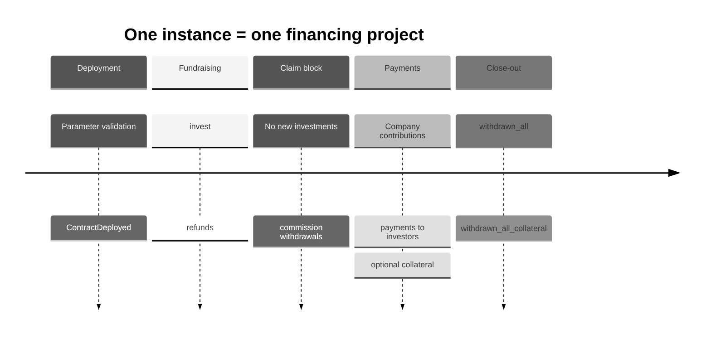

# Deploying the contract

An Equillar contract instance represents **one financing project** with its own immutable economic setup.

## Clone the equillar contract

Clone the equillar contract using git:

```bash
git clone https://github.com/icolomina/equillar-soroban.git
```

Then you can go into the project folder and execute the tests:

```bash
cd contracts/investment-income-based
cargo test
```

## Creating a stellar identity

Before deploying, you need a local identity to act as the source account for the upload and deploy commands. `stellar keys generate` creates a new keypair and stores it locally under the given alias (`admin` in this case), while `stellar keys fund` requests test funds (via Friendbot) to activate that account on the network. This only works on `testnet`; on `mainnet` the account must be funded manually.

> More information about installing stellar-cli in the [official Stellar documentation](https://developers.stellar.org/docs/tools/cli/install-cli).

```bash
stellar keys generate admin
stellar keys fund admin
```

## Build the contract

For building the contract and generating the wasm file, proceed as follows from the `contracts/investment-income-based` folder:

```bash
stellar contract build
```

After the command finishes, you will find the wasm file under `target/wasm32v1-none/release/` (the path is relative to the repo root).

## Upload the contract

Before deploying an instance of the contract, we need to install it in the network:

```bash
stellar contract upload \
  --wasm target/wasm32v1-none/release/<your_wasm_filename>.wasm \
  -s admin \
  --network testnet
```

After the command finishes, you will get the contract wasm hash that you will use later to deploy an instance of the contract.

> The `-s admin` flag (short for `--source-account`) tells the CLI to sign and submit this transaction using the `admin` identity created above.

## Deploy the contract

### Contract deployment parameters

The equillar contract `__constructor` method must receive the following parameters:

| Parameter | Type | Description |
|---|---|---|
| `admin_addr` | `Address` | Address of the contract's administrator (top-level authority). The admin controls role management, payments, withdrawals, collateral settlement, emergency close, and pausing. Deposit inflows (`invest`) must instead be signed by addresses holding the `operator` role. |
| `token_addr` | `Address` | Address of the token (SEP-41) used for all financial flows (deposits, payouts, returns). |
| `price_oracle` | `Address` | Address of the price oracle contract used to value the collateral token against the contract's token. Covered in detail in the [Collateral](./collateral.md) section. |
| `investment_params` | `InvestmentContractParams` | Struct holding the economic and time-related parameters (see next section). |

All constructor parameters are validated at deployment; a zero-valued `i_rate`, `goal`, `return_months`, `min_per_investment`, or any `cmr_*` parameter is rejected, as is `cmr_upper_divisor <= cmr_lower_divisor`. `return_type` must be `1` (ReverseLoan) or `2` (Coupon).

> **Note about the token addr:** Equillar is designed around stablecoins as the settlement token (`token_addr`). Returns are meant to reflect the performance of the underlying financed project — not the price behavior of the token used to move capital. Using a volatile asset instead would introduce a source of risk entirely unrelated to the investment itself, undermining the predictability that structured financing products are meant to provide. Since stablecoins are typically regulated and pegged to a fiat currency, they keep that additional volatility out of the equation.

### Investment Params

| Field | Type | Description |
|---|---|---|
| `i_rate` | `u32` | Interest/return rate offered to investors, expressed in basis points (e.g. `500` = 5.00%). |
| `fundraising_days` | `u64` | Duration in days of the fundraising phase. |
| `claim_block_days` | `u64` | Number of days during which claims are blocked/unavailable, counted after the fundraising period closes. |
| `goal` | `i128` | Fundraising goal, expressed using the number of decimals defined by the token. For example, for a token with 7 decimals, to express 1 unit you must send `1 × 10^7 = 10000000`. |
| `return_type` | `u32` | Payment scheme for investor returns: `1` = ReverseLoan, `2` = Coupon. **ReverseLoan**: capital plus gains are distributed together across the configured months. **Coupon**: gains are paid out first across the configured months, with the capital returned in the final payment (bond-like). See [Payment rounds](./payment-rounds.md). |
| `return_months` | `u32` | Number of months over which the return is distributed to investors. |
| `min_per_investment` | `i128` | Minimum amount allowed per individual investment, expressed using the number of decimals defined by the token. |
| `cmr_upper_divisor` | `u32` | Maximum divisor applicable to the commission. |
| `cmr_lower_divisor` | `u32` | Minimum divisor applicable for calculating the commission. |
| `cmr_reductor` | `i128` | Number of token units invested by which the divisor increases by one. |

> **Note on the `cmr_` parameters:** these three parameters configure the **decreasing commission model**; they are explained with a worked example in [Fundraising and positions](./fundraising-and-positions.md).

> **Note on `claim_block_days`:** the appropriate length of this window is up to the integrator and typically depends on the nature of the financed project. Project type matters — financing a truck fleet (operational quickly) differs from financing a solar plant (longer build-out, more exposure to technical/bureaucratic delays). Company profile matters too — fast-growing, cash-burning companies (e.g. startups) would require longer lock periods, reflecting their higher risk profile, compared to more established businesses.

### Deployment example with `stellar-cli`

Since the soroban version that supports constructors (protocol ≥ 22), `stellar contract deploy` accepts constructor arguments after `--`, the same way `stellar contract invoke` does. Simple types (`Address`, `String`, `u32`, `u64`) are passed as plain text; custom structs are passed as a JSON object whose keys match the struct's field names.

```bash
stellar contract deploy \
  --wasm-hash <hash> \
  -s admin \
  --network testnet \
  -- \
  --admin_addr GBOWNERXXXXXXXXXXXXXXXXXXXXXXXXXXXXXXXXXXXXXXXXXXXXXXXXX \
  --token_addr CATOKENXXXXXXXXXXXXXXXXXXXXXXXXXXXXXXXXXXXXXXXXXXXXXXXXX \
  --price_oracle COAXXXXXXXXXXXXXXXXXXXXXXXXXXXXXXXXXXXXXXXXXXXXXXXXXXXX \
  --investment_params '{
    "i_rate": 500,
    "claim_block_days": 180,
    "fundraising_days": 60,
    "goal": "10000000000000",
    "return_type": 2,
    "return_months": 12,
    "min_per_investment": "1000000000",
    "cmr_upper_divisor": 60,
    "cmr_lower_divisor": 10,
    "cmr_reductor": "4000000000"
  }'
```

The `goal`, `min_per_investment`, and `cmr_reductor` parameters: they are scaled according to the token's decimals (7 decimals in this example).

- **`goal`**: `1000000_0000000` → 1000000 tokens.
- **`min_per_investment`**: `100_0000000` → a minimum investment of 100 tokens.
- **`cmr_reductor`**: `400_0000000` → the commission divisor rises by one every 400 tokens invested.

`goal`, `min_per_investment`, and `cmr_reductor` are `i128`, so they must be passed as **strings** in the JSON payload (not as plain numbers).

> **About the struct keys order:** the CLI matches the JSON keys against the struct fields **by name**, so the order of the object is not strictly required. The example lists them in the same order as the `InvestmentContractParams` declaration for readability, and it is good practice to keep that order so the payload can be compared against the code at a glance.

For getting the public address (`G...`) of the `admin_addr` parameter you can derive it from the admin identity we created before generating the contract wasm:

```bash
stellar keys public-key admin
```

## Lifecycle of a contract instance

From deployment to completion, an instance moves through four time-gated phases:



## Balance and Events

### Balance

Equillar tracks the contract's financial state through a `Balance` snapshot based on **double-entry accounting** with assets, liabilities, and equity. The structure is updated after every relevant operation (investments, payments, withdrawals, collateral movements, refunds, etc.), and the accounting equation is verified after each update.

It is described in detail in [The Balance model](./balance-model.md); here we only introduce it, because every subsequent section shows which fields changed and which events were emitted.

The balance can be queried at any time through the read-only function `get_contract_balance(env: Env, caller: Address)`. The caller must be the `admin` or hold any existing role (`operator`, `company`, or `manager`).

```bash
stellar contract invoke \
  --id <YOUR_CONTRACT_ID> \
  -s admin \
  --network testnet \
  -- \
  get_contract_balance \
  --caller "G...."
```

### Events after deployment

Right after a successful deployment, the contract emits a `ContractDeployed` event:

```rust
ContractDeployed {
    addr,                  // the address of the newly deployed contract
    ts_fundraising_ends,   // timestamp when the fundraising period closes
    ts_payments_start,     // timestamp when the payment schedule begins
}
```

This event lets integrators know the key dates (fixed on-chain) without having to poll the contract state directly.

At this point, the balance is fully zero-initialized — no investments, payments, collateral, or withdrawals have taken place yet:

```text
assets:
  payment_rigths                    = 0
  contract_earnings                 = 0
  managed_volume                    = 0
  managed_collateral                = 0
liabilities:
  payment_obligations               = 0
  return_collateral_obligations     = 0
equity:
  contract_commissions              = 0
```

### Reading events with stellar-cli

Contract events can be queried directly using the `stellar events` command, filtering by contract ID and, optionally, by topic:

```bash
stellar events \
  --id <CONTRACT_ID> \
  --network testnet \
  --start-ledger <LEDGER_NUMBER> \
  --type contract
```

Events emitted with `#[contractevent]` automatically publish the event's name as part of their topics, along with any field explicitly marked with `#[topic]`. This means a query can be narrowed down to only `ContractDeployed` events using `--topic`:

```bash
stellar events \
  --id <CONTRACT_ID> \
  --network testnet \
  --start-ledger <LEDGER_NUMBER> \
  --topic "ContractDeployed,*" \
  --type contract
```
