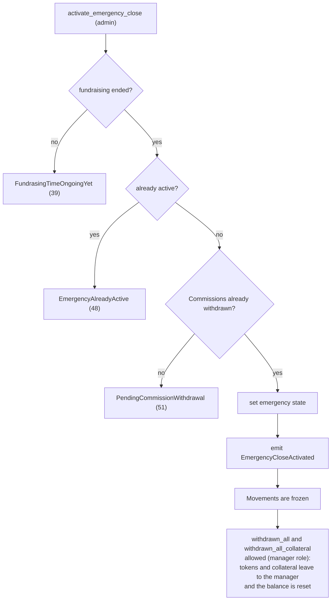

# Emergency close

Emergency close is the engine's **terminal post-financing-period close-out gate**. It can be activated when the company is expected to fail and there is no collateral left to cover the positions. From that point on, the instance freezes and its remaining funds can only leave through:

- The ([`withdrawn_all`](./withdrawals.md#final-sweep--withdrawn_all)) function that withdraws all remaining funds from the contract.
- The ([`withdrawn_all_collateral`](./collateral.md#collateral-final-sweep--withdrawn_all_collateral)) function that withdraws the remaining collateral from the contract (if any).

## What it is and what it is not

> It is **not** the same as [`refund_investor`](./refunds.md): refunds return deposited amounts to investors while *the financing period is still active*, before the company has started spending the raised funds. Emergency close is the post-fundraising path.

> **Collateral vs. emergency close:** they have different purposes. Collateral acts as a per-position safeguard, i.e. an individual position that cannot be covered from the contract's funds can be settled immediately with the available collateral, without affecting the rest of the project. Emergency close is the project-wide terminal gate, reserved for when that safeguard is no longer enough.

## Activating the emergency close

Activation is done by the admin through the function `activate_emergency_close()`:

```bash
stellar contract invoke \
  --id <YOUR_CONTRACT_ID> \
  -s admin \
  --network testnet \
  -- \
  activate_emergency_close
```

Activation is accepted only when **all** of the following hold:

| Check | Error if not satisfied |
|---|---|
| The fundraising period has already ended | `FundrasingTimeOngoingYet` (39) |
| Emergency close has not already been activated | `EmergencyAlreadyActive` (48) |
| All pending commissions are already withdrawn | `PendingCommissionWithdrawal` (51) |

## What changes once emergency mode is active

Once activated, *every* capital-moving entrypoint: `invest`, `process_investor_payment`, `refund_investor`, `add_company_transfer`, `withdrawn`, and `withdrawn_commissions` rejects calls with `OperationNotAllowedInEmergency` (50). Collateral settlement (`pay_with_collateral`) and `add_collateral` are equally blocked by their pause/emergency guards.

Emergency activation **does not modify the balance**. It sets the emergency state flag and the funds remain in the contract under the same `Balance` fields as before. As seen in [`withdrawn_all`](./withdrawals.md#final-sweep--withdrawn_all) and [`withdrawn_all_collateral`](./collateral.md#collateral-final-sweep--withdrawn_all_collateral), the remaining funds (tokens and collateral) go out to a `manager` address.

> **Important note**: `withdrawn_all` checks that the collateral has been withdrawn previously before withdrawing the remaining funds and resetting the balance. Therefore, the collateral must be withdrawn as a prior step to `withdrawn_all`.



> **Honest operational note:** emergency close is a **freeze**, not an automated payout process. The contract has no per-investor emergency payout entrypoint. With the emergency active, `withdrawn_all` sweeps the full contract token balance — including funds still owed to investors, if any — to the `manager` address, and `withdrawn_all_collateral` does the same with the remaining collateral; from there it is the integrator who decides off-chain what to do with those funds. Integrators should treat collateral liquidation and regular rounds as the real settlement paths *before* resorting to emergency close.

## Events after activating emergency close

**`EmergencyCloseActivated`**:

```rust
EmergencyCloseActivated {
    addr,   // the address of the contract
}
```

### Reading this event with stellar-cli

```bash
stellar events \
  --id <YOUR_CONTRACT_ID> \
  --network testnet \
  --start-ledger <LEDGER_NUMBER> \
  --type contract \
  --topic "EmergencyCloseActivated,*"
```

## Closing an instance end to end

The full closing sequence integrators should be ready for:

```text
1. Settle positions (recommended before activation): regular payment rounds
   and/or pay_with_collateral to reduce payment_obligations.
2. Withdraw pending commissions (withdrawn_commissions) — required:
   equity contract_commissions must be 0 for the activation to succeed.
3. activate_emergency_close (admin) — freezes the instance.
4. withdrawn_all_collateral (admin, manager receiver) — sweeps the remaining
   collateral to the manager and keeps the Balance settled.
5. withdrawn_all (admin, manager receiver) — sweeps any remaining token
   balance (settled or pending obligations) and resets the Balance.
   Instance fully closed.
```

Step 1 and the collateral return (`return_collateral_to_company`) must happen **before** activation if you want to use them: after it, the settlement entrypoints are blocked and only `withdrawn_all` and `withdrawn_all_collateral` remain possible.
