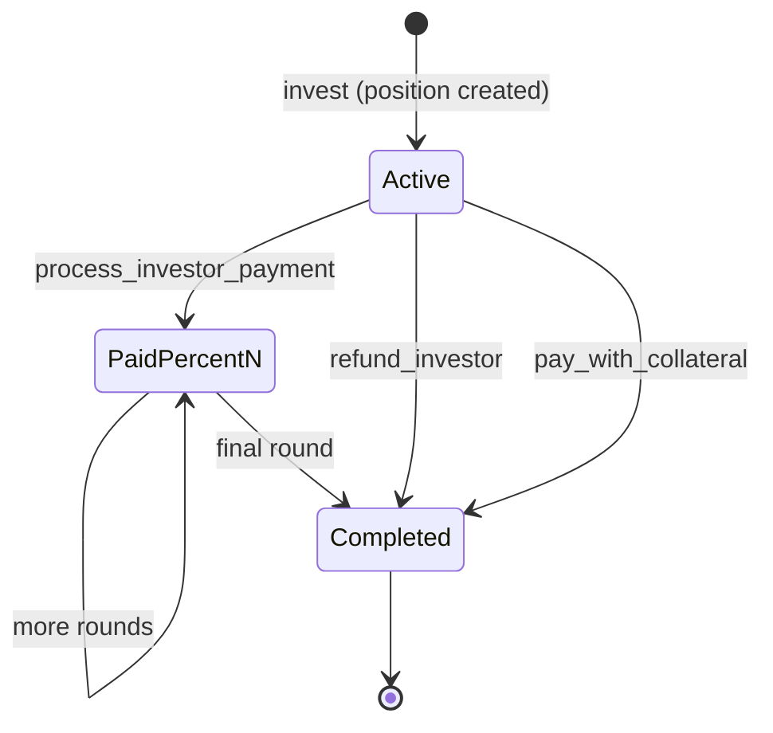
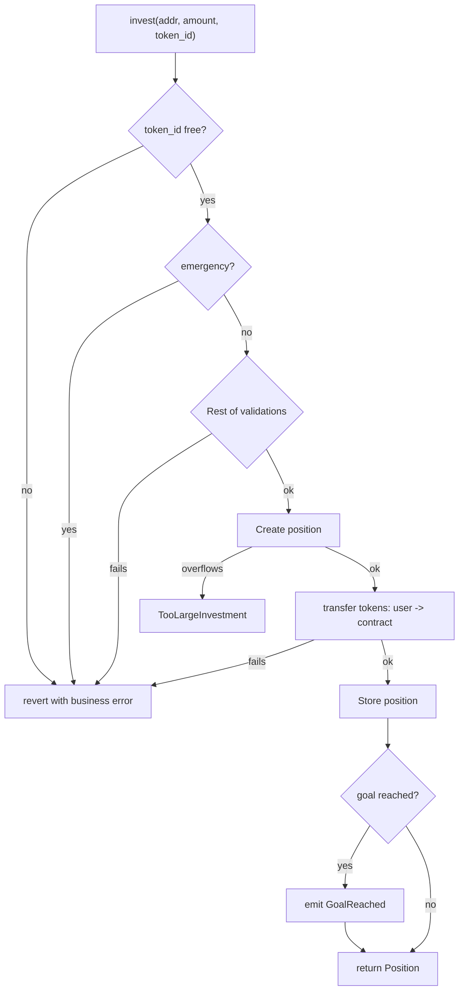

# Fundraising and positions

During the fundraising window, Equillar accepts investments through the `invest(investor, amount, position_id)` function. Only `operator` addresses are allowed to invoke it and, in addition, the contract must not be paused.

## Calling the invest function

```bash
stellar contract invoke \
  --id <YOUR_CONTRACT_ID> \
  -s operator \
  --network testnet \
  -- \
  invest \
  --addr "G....." \
  --amount "5000000000" \
  --token_id 1234
```

> The `addr` parameter must carry the operator identity address; `token_id` is the `position_id` provided by the integrator.

Each `position_id` identifies a position that holds (among others):

- how much was really deposited (net of commission)
- how much the investor will earn
- how much will be received per payment round

The `position_id` is **not generated on-chain but off-chain by the integrator**. Equillar simply maps each `position_id` to the address that invested through it. Payments for that position are later sent to that address. As an example, think of a `position_id` that does not represent a single investment but a collective group of investors: Equillar sends the corresponding payments to the mapped address, and the integrator distributes them among the various investors.

## Fundraising constraints

An investment is accepted only if **all** of the following hold (checked in this order):

| Check | Error if violated |
|---|---|
| No position is associated yet with the received identifier | `PositionIdAlreadyExists` (53) |
| Contract is not in emergency state | `OperationNotAllowedInEmergency` (50) |
| Raised so far (contract token balance) is still below `goal` | `GoalReached` (30) |
| The invested amount must be greater than or equal to the minimum per investment | `AmountLessThanMinimum` (5) |
| The investing address holds enough token balance | `AddressInsufficientBalance` (1) |
| The investment date is within the fundraising window | `FundrasingTimeExceeded` (40) |

Additionally, the allocation math must succeed: amounts so large they overflow the fixed-point (WAD) arithmetic used internally are rejected with `TooLargeInvestment` (61) — see [The limit of very large deposits](#the-limit-of-very-large-deposits).

## Investment allocation

The gross investment amount is split into two buckets:

1. **project amount** (deposited)
2. **commission amount**

The commission is dynamic and depends on investment size and the configured rate logic. Larger investments increase the denominator tier and reduce the effective commission rate. The integrator configures the rate at which commissions are reduced at the time of deployment using:

- `cmr_upper_divisor`
- `cmr_lower_divisor`
- `cmr_reductor`

### Step 1 — commission denominator tier

At the contract level the denominator follows this rule:

```text
denominator = cmr_lower_divisor + (amount / cmr_reductor)    // integer division, floored
if denominator > cmr_upper_divisor: denominator = cmr_upper_divisor
```

So the tier **starts at `cmr_lower_divisor`**, increases by **1** for every additional `cmr_reductor` token units invested (integer floor), and is **capped at `cmr_upper_divisor`**.

Example with `cmr_reductor = 400_0000000` (400 tokens, 7 decimals):

```text
0 to 399.999... tokens invested   -> denominator 10  (cmr_lower_divisor)
400 to 799.999... tokens invested  -> denominator 11
800 to 1199.999... tokens invested -> denominator 12
...
```

This ratio is what makes the commission model **decreasing** rather than flat: every additional 400 tokens invested lowers the effective rate, until the cap.

### Step 2 — commission and returns

With the tier resolved, the allocation is:

```text
commission_rate = i_rate / (denominator × 10_000)
commission      = amount × commission_rate          (floored to token units)
deposited       = amount - commission

return_rate     = i_rate / 10_000
returns         = deposited × return_rate           (floored to token units)

total           = deposited + returns               (what the investor is entitled to)
```

Note that the returns are computed over the **deposited** amount (net of commission), not over the gross amount.

## Token-scale example

The following example uses the parameters from the deployment example in [Deploying the contract](./deploying-the-contract.md#deployment-example-with-stellar-cli):

- investment amount: `500` tokens = `5_000000000` raw units
- `i_rate = 500` (5%)
- `return_months = 12`
- `cmr_upper_divisor = 60`, `cmr_lower_divisor = 10`, `cmr_reductor = 4_000000000` (400 tokens)

### Tier

```text
step          = 5_000000000 / 4_000000000 = 1   (integer division)
denominator   = 10 + 1 = 11                    (below the cap of 60)
```

### Commission

```text
commission_rate = 500 / (11 × 10_000) = 500 / 110_000 ≈ 0.45%
commission_raw  = floor(5_000000000 × 500 / 110_000) = 22_727272   (2.2727272 tokens)
deposited       = 5_000000000 - 22_727272 = 4_977272728            (497.7272728 tokens)
```

### Returns and total

```text
returns = floor(4_977272728 × 5%) = 248_863636                     (24.8863636 tokens)
total   = 4_977272728 + 248_863636 = 5_226136364                   (522.6136364 tokens)
regular_payment (Coupon) = 248_863636 / 12 = 20_738636             (2.0738636 tokens per round)
```

> **Why do we divide by `10_000`?** The `i_rate` is expressed in **basis points**: one basis point is one hundredth of a percent, i.e. `1/10_000 = 0.0001`. The `500` in the example becomes a fraction in two steps of division by 100:
>
> ```text
> 500 ÷ 100 = 5      → "5" as a percentage number (5.00)
> 5   ÷ 100 = 0.05   → the real fraction of 5%
> ```
>
> Two divisions by 100 equal one division by `10_000`. Since the **commission** rate is additionally divided by the denominator tier (11 in the example), the contract joins everything into a single denominator — `i_rate / (tier × 10_000)` — and resolves it in a single division.

## The limit of very large deposits

Internally, the allocation math is performed in **WAD fixed-point arithmetic** (a fixed 10^18 scale maintained by the OpenZeppelin math library) with **checked operations**. Deposits are first converted to the internal scale and then validated so that no intermediate multiplication can overflow:

```text
maximum representable amount ≈ 10^27 raw units for a 7-decimals token
                              (i128::MAX / 10^(18 - decimals))
```

Deposits beyond that range cannot safely participate in the allocation and are rejected **cleanly** with `TooLargeInvestment` (61): the position is not created, **no token transfer is performed**, and the balance is left exactly as before. There is no trap or panic for oversized deposits from the investor side.

## Position state machine

A position moves through very few states:



A completed position receives no more payments, refunds, or collateral settlements.

## The investment flow



> **Ordering note:** the allocation is computed **before** the token transfer. If the allocation cannot be represented (overflowing deposit), the transfer never happens. The investor's balance is never touched on up-front rejection.

## Events and balance after a new investment

When a new deposit is accepted, the contract updates the balance through `recalculate_from_position`:

- `assets.contract_earnings += commission`
- `assets.managed_volume += total`
- `equity.contract_commissions += commission`
- `liabilities.payment_obligations += total`

(the equation is verified before persisting — see [The Balance model](./balance-model.md))

Three events are part of this flow:

**1. `BalanceUpdated`** — the updated balance snapshot:

```rust
BalanceUpdated {
    assets: BalanceAsset { payment_rigths, contract_earnings, managed_volume, managed_collateral },
    liabilities: BalanceLiabilities { payment_obligations, return_collateral_obligations },
    equity: BalanceEquity { contract_commissions },
}
```

**2. `InvestmentReceived`** — details of the investment itself:

```rust
InvestmentReceived {
    addr,           // the address of the contract
    deposited,      // net deposit amount placed under management (amount - commission)
    capital_gains,  // the yield the investor will receive
}
```

**3. `GoalReached`** — if the deposit causes the fundraising goal to be reached (checked against the contract token balance after the transfer):

```rust
GoalReached {
    addr,             // the address of the contract
    total_received,   // the contract token balance at that moment
    goal,             // the fundraising goal configured at deployment
}
```

### Reading these events with stellar-cli

```bash
stellar events \
  --id <CONTRACT_ID> \
  --network testnet \
  --start-ledger <LEDGER_NUMBER> \
  --type contract \
  --topic "InvestmentReceived,*"
```

```bash
stellar events \
  --id <CONTRACT_ID> \
  --network testnet \
  --start-ledger <LEDGER_NUMBER> \
  --type contract \
  --topic "GoalReached,*"
```
