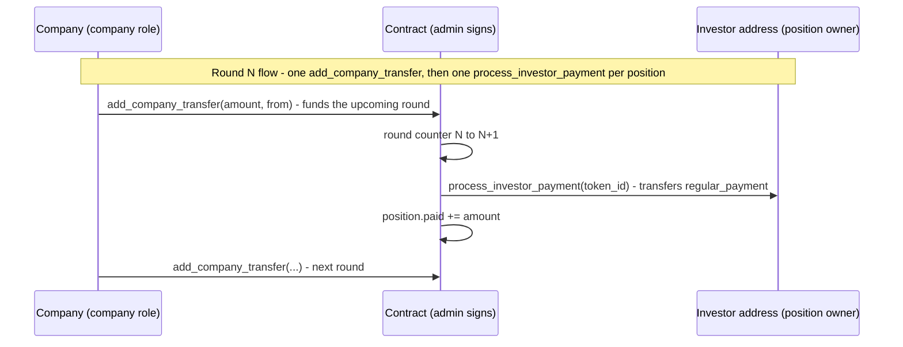

# Payment rounds

After the claim block window ends (the period after the fundraising), the project enters the regular payment phase. Equillar does **not** force integrators to execute the payments within the contract, since there is a mode in which positions are updated on-chain but the token transfers are done by other means. Let's explore both modes.

## Payment rounds with in-contract transfers

These rounds are carried out in two steps:

1. The company transfer (`add_company_transfer`)
2. The payments to each position (`process_investor_payment`)



### The company transfer

In this first step, the company (from an address holding the `company` role) transfers sufficient funds to cover the corresponding payments for the next round, through `add_company_transfer(amount, from)`:

```bash
stellar contract invoke \
  --id <YOUR_CONTRACT_ID> \
  -s admin \
  --network testnet \
  -- \
  add_company_transfer \
  --amount "21000000" \
  --from "G....."
```

Company transfers are allowed only if all of the following conditions are met:

| Check | Error if not satisfied |
|---|---|
| Contract is not paused | paused guard |
| No active emergency | `OperationNotAllowedInEmergency` (50) |
| Current date within the round window | `NextPaymentCannotBeScheduledYet` (43) |
| Enough funds to cover the payment | `ContractReserveInsufficientBalance` (2) |
| The `from` address holds enough token balance | `OwnerInsufficientBalance` (47) |

After the company transfers the funds, payments are not executed automatically. The funds stay held by the contract until each position's payment function is called. The round number is **incremented** so that the current round is marked as done: if the round number were not incremented, the payment function would attempt to pay an already-paid round and fail.

### The payment function

Payments to investors are carried out through `process_investor_payment(token_id)`:

```bash
stellar contract invoke \
  --id <YOUR_CONTRACT_ID> \
  -s admin \
  --network testnet \
  -- \
  process_investor_payment \
  --token_id 1234
```

Payments are allowed only if all of the following conditions are met:

| Check | Error if not satisfied |
|---|---|
| Contract is not paused / no active emergency | paused guard / (50) |
| The position exists | `AddressHasNotInvested` (14) |
| The position is not completed | `PositionCompleted` (38) |
| The round has not been paid yet for the position | `PaymentAlreadyProcessedForThisPeriod` (42) |
| Enough funds exist to cover the payment | `ContractReserveInsufficientBalance` (2) |

After the function is executed, the payment is sent to the position owner: the operator address that called `invest` with this `token_id`. `process_investor_payment` is called individually for each `token_id` that invested in the project. This results in many calls to the contract, but in return it gives integrators the flexibility to distribute payments according to their needs.

> **Per-position, per-round discipline (in-contract transfer mode).** The round check is strict *per position*: a position skipped in round N cannot be paid later since at N+1 its internal counter no longer matches. Failing to pay a position within its round permanently blocks that position (error 42), so it is necessary to integrate a reliable scheduler that pays every position on every round before funding the next round via `add_company_transfer`. This applies when in-contract liquidations are **enabled** (the default); the no-transfer mode bypasses this check (see below).

### How much is paid each round?

The per-round amount depends on the `return_type`:

- **Coupon**: pays `regular_payment` = `returns / return_months` per round. In the **final round** (`payments_transferred == return_months`) the contributed capital is also paid (deposited — with the commission already deducted).
- **ReverseLoan**: pays `regular_payment` = `total / return_months` per round.

Continuation of the [token-scale example](./fundraising-and-positions.md#token-scale-example) (Coupon, 12 months, position with `total = 5_226136364`):

```text
rounds 1..11:  single amount = 20_738636 each  (2.0738636 tokens)
round 12 (last):
  amount_to_transfer = (total - paid) + deposited
                     = 248_863636 - 11 × 20_738636 + 4_977272728
                     = 20_738640 + 4_977272728
                     = 4_998_011_368      (499.8011368 tokens)

total received by the investor = 11 × 2.0738636 + 499.8011368
                               = 22.8124996 + 499.8011368 = 522.6136364 = total ✓
```

The Coupon schedule behaves bond-like: interest first, capital returned in the last payment. ReverseLoan instead amortizes `total/return_months` every month.

## Payment rounds without in-contract transfers

Equillar does not force integrators to transfer the payments within the contract. This mode is configured during the claim block window (see below) and it changes what `process_investor_payment` does: the position is updated on-chain (round counters, `paid`, completion) but **no token transfer is performed** and no reserve check applies. The integrator sends the payment through an alternative method (e.g. off-chain ordering) and the contract simply records it.

### Enabling / Disabling investment liquidations

The contract exposes:

- **`enable_investment_liquidations`** (admin)
- **`disable_investment_liquidations`** (admin)
- **`check_investment_liquidations`** (admin or any role; read-only, allowed even while paused)

```bash
stellar contract invoke \
  --id <YOUR_CONTRACT_ID> \
  -s admin \
  --network testnet \
  -- \
  disable_investment_liquidations
```

Both `enable_*` and `disable_*` are only accepted during the claim block window — strictly after the fundraising end and strictly before the payments start (`LiquidationPaymentsOutOfPeriod`, 54).

> **The default mode is with in-contract transfers**: if these functions were never called, investment liquidations are assumed to be **Enabled**, i.e. the default behavior is that the contract itself performs the token transfers.

### Round behavior in the no-transfer mode

With liquidations **disabled**, the strict round/reserve validation is bypassed: `process_investor_payment` neither checks the round counter nor the reserve, and performs no token transfer — it only updates the position on-chain (`payments_transferred`, `paid`, completion in the final round). Consequently:

- `add_company_transfer` is **not required** to advance rounds in this mode (the round check simply does not apply); call it only if you still want the accounting entry for the company's contributions.
- Call `process_investor_payment` whenever an off-contract payment has been sent for a position; skipping rounds is not penalized, since no contract reserve is involved.

Everything remains consistent in the `Balance`: each call still lowers `managed_volume` and `payment_obligations`, so the double-entry equation keeps tracking the reality that the integrator settles off-contract.

```bash
stellar contract invoke \
  --id <YOUR_CONTRACT_ID> \
  -s admin \
  --network testnet \
  -- \
  process_investor_payment \
  --token_id 1234
```

## Events and balance after a company transfer

When the company transfers funds for the upcoming round through `add_company_transfer`, the balance is updated via `recalculate_from_company_contribution`:

- `assets.payment_rigths -= amount` (the company's payment obligations to the contract decrease)
- `assets.managed_volume += amount` (the contract's managed volume increases)

(the net asset total remains unchanged — the tokens physically arrived and are reclassified as managed volume; see [The Balance model](./balance-model.md#assets--what-the-contract-manages))

This update is published through the standard `BalanceUpdated` event. In addition, the contract emits a dedicated event with the transfer details:

**`CompanyTransferReceived`**:

```rust
CompanyTransferReceived {
    addr,             // the address of the contract
    total_received,   // the total amount transferred by the company
}
```

### Reading this event with stellar-cli

```bash
stellar events \
  --id <CONTRACT_ID> \
  --network testnet \
  --start-ledger <LEDGER_NUMBER> \
  --type contract \
  --topic "CompanyTransferReceived,*"
```

## Events and balance after a regular investor payment

When a payment round is processed for an investor through `process_investor_payment`, the balance is updated via `recalculate_from_payment_to_investor`:

- `assets.managed_volume -= amount` (the managed volume decreases)
- `liabilities.payment_obligations -= amount` (the payment obligations to the investor also decrease on the liabilities side)

This update is published through the standard `BalanceUpdated` event. In addition, the contract emits a dedicated event with the payment details:

**`PaymentSent`**:

```rust
PaymentSent {
    addr,         // the address of the contract
    total_sent,   // the total amount sent to the investor
}
```

### Reading this event with stellar-cli

```bash
stellar events \
  --id <CONTRACT_ID> \
  --network testnet \
  --start-ledger <LEDGER_NUMBER> \
  --type contract \
  --topic "PaymentSent,*"
```
