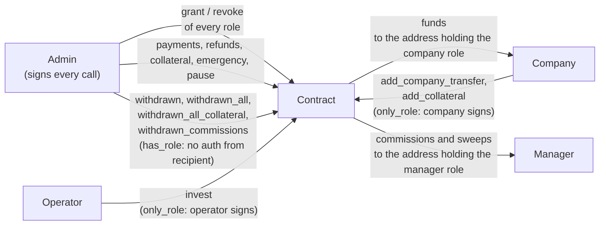

# Role setup and revocation

After deployment, the admin can begin configuring the actors that will have permission to operate the project (contract instance). Equillar defines a set of roles, and every address involved in the contract's capital in/out flows must be granted one of these roles before it can interact with them.

## Roles

| Role | Purpose | Signing model |
|---|---|---|
| **Admin** | Top-level authority over role management, payment processing, treasury actions, collateral settlement, emergency close, and pausing/unpausing the contract. Established at deploy and transferable in two steps (`transfer_admin_role` + `accept_admin_transfer_role`). | Signs the privileged calls. |
| **Operator** | Creates new investments (`invest`) for investor addresses. Particularly useful for regulated actors who share a single address across many end users. | Signs the `invest` calls. |
| **Company** | Designates the address authorized to fund payment rounds (`add_company_transfer`), receive project funds (`withdrawn`), and deposit collateral (`add_collateral`). | Signed by the admin, but the destination address must hold this role. |
| **Manager** | Designates the address authorized to receive the integrator's commissions (`withdrawn_commissions`) and the final sweep operations (`withdrawn_all`, `withdrawn_all_collateral`). | Signed by the admin, but the destination address must hold this role. |

Role cardinality: **`operator` is multi-holder** (many addresses can hold it simultaneously), while **`company` and `manager` are single-holder** — the contract enforces one member per role, with explicit errors if the rule is violated:

| Error | Code | Meaning |
|---|---|---|
| `AddressAlreadyHoldsRole` | 16 | The address being granted already holds that role. |
| `AddressRoleAlreadyExists` | 17 | Granting `company` or `manager` again while the role is already taken. |

## Grant and revoke flows

The admin can use:

- `grant_operator` / `revoke_operator`
- `grant_company` / `revoke_company`
- `grant_manager` / `revoke_manager`

Revoking a role takes effect immediately at the contract layer. For example, a revoked operator can no longer create new investments, although positions it created earlier continue to exist and receive payments.

All grant/revoke operations are admin-only and are blocked while the contract is paused.

The following commands show how to grant and revoke an operator by calling the corresponding functions via stellar-cli:

### Create a new identity for the operator

```bash
stellar keys generate operator
stellar keys fund operator
```

### Get the operator's public key

```bash
stellar keys public-key operator
```

### Grant the operator role by calling the corresponding contract function

```bash
stellar contract invoke \
  --id <YOUR_CONTRACT_ID> \
  -s admin \
  --network testnet \
  -- \
  grant_operator \
  --operator <THE_OPERATOR_ADDRESS>
```

The `<THE_OPERATOR_ADDRESS>` value is the address returned by the `stellar keys public-key operator` command above.

### Revoke the operator role by calling the corresponding contract function

```bash
stellar contract invoke \
  --id <YOUR_CONTRACT_ID> \
  -s admin \
  --network testnet \
  -- \
  revoke_operator \
  --operator <THE_OPERATOR_ADDRESS>
```

## How roles map to the lifecycle

The key to reading the diagram: **the admin signs all privileged operations**. The `company` and `manager` addresses do not initiate calls; when they act as fund **recipients** (`withdrawn`, `withdrawn_commissions`, `withdrawn_all`, `withdrawn_all_collateral`) the contract only checks that they hold the assigned role — via the `has_role` macro, which does **not** enforce authorization from the recipient (see [OpenZeppelin AccessControl](https://docs.openzeppelin.com/stellar-contracts/access/access-control#role-checking-macros)). By contrast, when a role address acts as the **source** (`invest` by the operator, `add_company_transfer` and `add_collateral` by the company) the `only_role` macro does enforce its authorization (`require_auth`).



> **Note:** granting and revoking the company and manager roles follows the exact same CLI process described above, using `grant_company` / `revoke_company` and `grant_manager` / `revoke_manager`.
