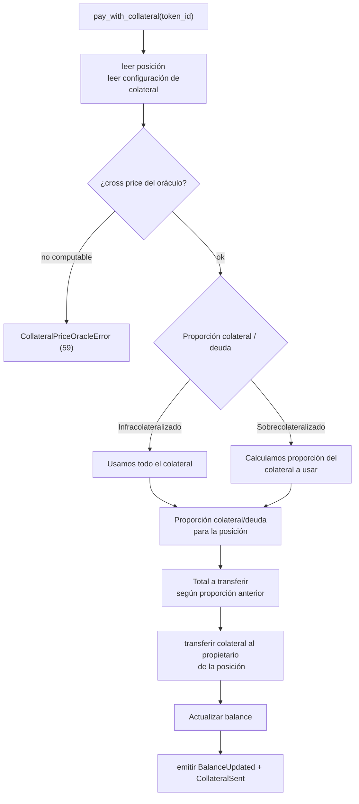

# Colateral

Equillar ofrece la opción de usar colateral para liquidar posiciones cuando la empresa no puede atender sus obligaciones de pago. Es una salvaguarda **por posición**, complementaria e independiente del [cierre de emergencia](./emergency-close.md).

## Añadir colateral

El colateral se añade mediante la función:

`add_collateral(collateral_token_addr, collateral_token_amount, collateral_token_symbol, collateral_addr)`

```bash
stellar contract invoke \
  --id <YOUR_CONTRACT_ID> \
  -s admin \
  --network testnet \
  -- \
  add_collateral \
  --collateral_token_addr "C...." \
  --collateral_token_amount "4000000000" \
  --collateral_token_symbol "ABC" \
  --collateral_addr "G..."
```

- **`collateral_token_addr`**: dirección del contrato del token que se usará como colateral.
- **`collateral_token_amount`**: cantidad de colateral depositada, en unidades de `collateral_token_addr`.
- **`collateral_token_symbol`**: código del token.
- **`collateral_addr`**: dirección que posee el colateral, desde la que se envían los fondos al contrato (el origen debe poseer el rol `company`).

La aportación de colateral al contrato fallará si no se cumple alguna de estas condiciones:

| Comprobación | Error si no se cumple |
|---|---|
| El contrato no está pausado | guard de pausa |
| Un solo token de colateral: si el colateral está ya configurado, el nuevo depósito debe usar el **mismo** token | `OnlyOneCollateralTokenAllowed` (34) |
| El proveedor (`collateral_addr`) tiene balance suficiente del token de colateral | `AddressInsufficientBalance` (1) |
| El nivel de colateral puede calcularse contra las obligaciones actuales | `CollateralLevelNotComputable` (33) |
| El proveedor firma y la transferencia del token tiene éxito | Errores de transferencia |
| El importe total no desborda | `CollateralAmountOverflow` (58) |

> **Ordenación y seguridad no-op:** el nivel de colateral se calcula **antes** de que se transfieran los tokens del proveedor. Si no puede establecerse el nivel (por ejemplo, por fallo del oráculo al devolver el par de precios), toda la operación revierte limpiamente, no se mueven tokens y el balance queda intacto.

> El error `CollateralLevelNotComputable` no expresa una política de nivel mínimo: cubre "el nivel de colateral no pudo computarse" (el pricing del oráculo falló) — el contrato actual exige poder *calcular* un nivel, no impone un valor mínimo para él.

## Calcular el nivel de colateral

La valoración del colateral depende del `price_oracle` configurado en el despliegue (ver [Despliegue del contrato](./deploying-the-contract.md)).

El contrato calcula un **nivel de colateral** (en puntos básicos, ×100 — p. ej. `6_000` = cobertura del 60%, `10_000` = 100%) de la siguiente forma:

1. Si no hay obligaciones de pago restantes, el nivel es `10_000` (100%) por definición — no hace falta llamar al oráculo.
2. Obtiene el precio del token de colateral y el del token del contrato del oráculo, ambos expresados en el activo base del oráculo a la escala decimal del oráculo.
3. Calcula el cross price: `collateral_price / contract_token_price`.
4. Convierte la cantidad de colateral a denominación del token del contrato multiplicándola por el cross price (en punto fijo, con aritmética checked).
5. Escala: `level = collateral_value × 10_000 / payment_obligations`.

Toda la aritmética es punto fijo WAD y checked; un precio de oráculo ausente **no** es un trap, sino que la operación devuelve un error de negocio en su lugar.

Para que un oráculo sea compatible con Equillar, debe implementar el siguiente trait:

```rust
#[contracttype]
#[derive(Clone)]
pub enum Asset {
    Stellar(Address),
    Other(Symbol),
}

#[contracttype]
#[derive(Clone)]
pub struct PriceData {
    pub price: i128,
    pub timestamp: u64,
}

#[contractclient(name = "ReflectorClient")]
pub trait ReflectorOracle {
    fn base(env: &Env) -> Asset;
    fn decimals(env: &Env) -> u32;
    fn lastprice(env: &Env, asset: Asset) -> Option<PriceData>;
}
```

[Reflector](https://reflector.network/) es un oráculo compatible y ha sido la implementación de referencia durante el desarrollo. Sin embargo, cualquier contrato de oráculo que implemente este trait puede ser usado por el integrador.

> **Guards de borde:** si el precio del oráculo para el token del contrato es `0` (denominador del cross price), o el oráculo simplemente no tiene precio para ninguno de los dos activos, la valoración devuelve `CollateralPriceOracleError` (59) / `CollateralLevelNotComputable` (33). Además, la liquidación proporcional se defiende contra un estado contable invalido: si `payment_obligations` fuera `<= 0`, el cálculo del ratio se rechaza con `EmptyPaymentObligations` (45) en lugar de hacer trap.

### Ejemplo

Supuestos:

- Token del contrato: USDC (7 decimales). Obligaciones de pago restantes: `10_000_0000000` (10.000 USDC).
- Token de colateral: 7 decimales, respaldado 1:1 por BTC. Cantidad: `1_500_000` unidades del token (0.15 BTC).
- Precios del oráculo (en el activo base del oráculo, USD): BTC = 60.000; USDC = 1.

**Paso 1 — Precios del oráculo**

- Precio del token de colateral: 60.000 USD
- Precio del token del contrato: 1 USD

**Paso 2 — Cross price**

```text
cross_price = 60_000 / 1 = 60_000
→ 1 unidad del token de colateral vale 60_000 unidades del token del contrato.
```

**Paso 3 — Valor del colateral en términos del token del contrato**

```text
collateral_value = 0.15 × 60_000 = 9_000 USDC
```

**Paso 4 — Nivel de colateral**

```text
collateral_level = 9_000 × 10_000 / 10_000 = 9_000  (bp) → cobertura del 90%
```

El colateral casi, pero no del todo, cubre las obligaciones de pago pendientes. El nivel devuelto se guarda con la configuración del colateral (`collateral_level`).

## Pagos con colateral

La liquidación de posiciones usando el colateral se hace con `pay_with_collateral(token_id)`:

```bash
stellar contract invoke \
  --id <YOUR_CONTRACT_ID> \
  -s admin \
  --network testnet \
  -- \
  pay_with_collateral \
  --token_id 1234
```

Condiciones:

| Comprobación | Error si no se cumple |
|---|---|
| El contrato no está pausado | guard de pausa |
| La posición existe / no está completada | `AddressHasNotInvested` (14) / `PositionCompleted` (38) |
| Hay colateral configurado para la instancia | `CollateralNotConfigured` (36) |
| La valoración puede computarse | `CollateralPriceOracleError` (59) |
| El estado contable es coherente (obligaciones de pago positivas) | `EmptyPaymentObligations` (45) |

La función transfiere al propietario de la posición la cantidad de colateral equivalente a las obligaciones pendientes de la posición en proporción al total de obligaciones pendientes:



**El tope:** antes de distribuir, el contrato comprueba si el colateral que mantiene vale *más* de lo que se debe actualmente. Si es así, la cantidad distribuida se limita a lo necesario (`remaining_obligations / cross_price`), de manera que las posiciones reciben colateral cuyo valor es exactamente su deuda pendiente — ni más ni menos.

### Ejemplo: distribuyendo el colateral

Datos de partida (del ejemplo de nivel de más arriba):

- Obligaciones de pago restantes: `10_000_0000000` (10.000 USDC).
- Colateral en poder: `1_500_000` unidades del token (0.15 BTC).
- Precios del oráculo: BTC = 60.000 USD; USDC = 1 → cross price 60.000.

Asumimos además que los 10.000 USDC de obligaciones totales se reparten en tres posiciones, de las cuales se liquidan las dos primeras en este walkthrough:

- Posición 1: 3.000 USDC pendientes
- Posición 2: 4.000 USDC pendientes
- Posición 3: 3.000 USDC pendientes

#### Comprobar si hay que aplicar el tope al colateral

```text
collateral_value      = 0.15 × 60_000 = 9_000 USDC
remaining_obligations = 10_000 USDC
```

Como `9.000 < 10.000`, el colateral **no** se limita — no hay más colateral que deuda, así que los `0.15` BTC quedan disponibles para la distribución proporcional.

#### Liquidando la posición 1

- Participación de la posición 1 en las obligaciones totales: `3.000 / 10.000 = 30%`
- Colateral transferido: `0.15 × 0.30 = 0.045` BTC

#### Liquidando la posición 2

- Colateral restante tras la posición 1: `0.15 - 0.045 = 0.105` BTC
- Obligaciones restantes tras la posición 1: `10.000 - 3.000 = 7.000` USDC
- El contrato re-verifica el tope: `0.105 × 60.000 = 6.300`, todavía menos que `7.000` asi que no se aplica tope
- Participación de la posición 2 en las obligaciones restantes: `4.000 / 7.000 ≈ 57.14%`
- Colateral transferido: `0.105 × 0.5714 ≈ 0.06` BTC

Tras estos dos pagos quedan `0.045` BTC en el contrato y 3.000 USDC de obligaciones siguen pendientes (posición 3), que se liquidarían igual en una llamada posterior.

### Ejemplo: Colateral en exceso de las obligaciones

Ahora el escenario opuesto: el colateral en poder vale **más** de lo que se debe, así que el tope se vuelve relevante.

Supuestos:

- Colateral en poder: 1 BTC (7 decimales).
- Precio del oráculo: BTC = 60.000 USDC.
- Tres posiciones a liquidar, en este orden:

| Posición | Obligaciones pendientes |
|---|---|
| A | 5.000 USDC |
| B | 6.000 USDC |
| C | 7.000 USDC |

Total de obligaciones: `18.000` USDC.

#### Liquidando la posición A

- Comprobación de colateral: `1 × 60.000 = 60.000 > 18.000` — se aplica el tope.
- Colateral limitado: `required = 18.000 / 60.000 = 0.3` BTC
- Participación de la posición A: `5.000 / 18.000 ≈ 27.78%`
- Colateral transferido: `0.3 × 0.2778 ≈ 0.0833` BTC

#### Liquidando la posición B

- Colateral restante: `1 - 0.0833 = 0.9167` BTC. Obligaciones restantes: `13.000` USDC.
- Verificación del tope: `0.9167 × 60.000 ≈ 55.000 > 13.000` — se aplica el tope.
- Colateral limitado: `13.000 / 60.000 ≈ 0.2167` BTC
- Participación de la posición B: `6.000 / 13.000 ≈ 46.15%`
- Colateral transferido: `0.2167 × 0.4615 ≈ 0.1` BTC 
#### Liquidando la posición C

- Colateral restante: `0.9167 - 0.1 = 0.8167` BTC. Obligaciones restantes: `7.000` USDC.
- Verificación del tope: `0.8167 × 60.000 ≈ 49.000 > 7.000` — se aplica el tope.
- Colateral limitado: `7.000 / 60.000 ≈ 0.1167` BTC
- Participación de la posición C: `7.000 / 7.000 = 100%`
- Colateral transferido: `0.1167` BTC 

#### Resultado

Cada posición recibe colateral que vale exactamente lo que se le debía, ni más ni menos. En total se liquidaron `0.0833 + 0.1 + 0.1167 = 0.3` BTC (que valen `18.000` USDC, coincidiendo exactamente con las obligaciones totales), dejando `0.7` BTC de colateral en exceso aún en poder del contrato.

## Devolver el colateral

Si el colateral nunca hizo falta, la compañía puede recuperarlo llamando a `return_collateral_to_company()` (solo admin):

```bash
stellar contract invoke \
  --id <YOUR_CONTRACT_ID> \
  -s admin \
  --network testnet \
  -- \
  return_collateral_to_company
```

Transfiere la **totalidad del balance restante del token de colateral** del contrato de vuelta a la dirección de la compañía configurada.

| Comprobación | Error si no se cumple |
|---|---|
| El contrato no está pausado | guard de pausa |
| Hay colateral configurado | `CollateralNotConfigured` (36) |
| Hay balance de colateral en el contrato | `CollateralBalanceIsEmpty` (37) |

> **Nota operacional:** el contrato no exige que las obligaciones de pago estén a cero para esta llamada sino que simplemente drena el balance de colateral en poder del contrato. Para el cierre por emergencia existe además [`withdrawn_all_collateral`](#barrido-final-del-colateral--withdrawn_all_collateral), que envía el colateral restante a una dirección `manager` en lugar de devolverlo al proveedor.

Contabilidad: `recalculate_from_collateral_returned` baja el activo de colateral y el pasivo correspondiente simétricamente.

## Barrido final del colateral — withdrawn_all_collateral

En el cierre por emergencia, el colateral restante **no** se devuelve al proveedor sino que se envía a una dirección con el rol `manager` para que sea el integrador quien decida qué hacer con él, igual que hace `withdrawn_all` con los fondos del token. La función es `withdrawn_all_collateral(to)`:

```bash
stellar contract invoke \
  --id <YOUR_CONTRACT_ID> \
  -s admin \
  --network testnet \
  -- \
  withdrawn_all_collateral \
  --to "G....."
```

Condiciones:

| Comprobación | Error si no se cumple |
|---|---|
| El contrato no está pausado / el admin firma | guard de pausa / rol |
| Hay colateral configurado para la instancia | `CollateralNotConfigured` (36) |
| `to` posee el rol `manager` | error de acceso |
| El cierre de emergencia está **activo** | `EmergencyNotActive` (49) |

Si el contrato aún mantiene tokens de colateral, la totalidad del balance se transfiere a `to` y el `Balance` y el balance descuenta la cantidad de colateral transferida tanto del activo como del pasivo (de la misma foma que cuando se devuelve a la compañía).

## Eventos

### Tras un depósito de colateral

- La cantidad de colateral se trackea vía `recalculate_from_collateral_received`: `assets.managed_collateral += amount`, `liabilities.return_collateral_obligations += amount`.
- El evento dedicado:

```rust
CollateralDeposited {
    addr,                        // la dirección del contrato
    current_collateral_amount,   // colateral total en poder del contrato, incluyendo este depósito
    total_deposited,             // la cantidad transferida en esta llamada concreta
    token_address,               // la dirección del token de colateral
    token_symbol,                // el símbolo del token de colateral
}
```

```bash
stellar events \
  --id <YOUR_CONTRACT_ID> \
  --network testnet \
  --start-ledger <LEDGER_NUMBER> \
  --type contract \
  --topic "CollateralDeposited,*"
```

### Tras una liquidación de colateral

- Balance actualizado vía `recalculate_from_collateral_liquidated` (baja `managed_collateral` / `return_collateral_obligations` por el colateral transferido y `managed_volume` / `payment_obligations` por las obligaciones restantes liquidadas) y publicado a través del evento estándar `BalanceUpdated`.
- El evento dedicado:

```rust
CollateralSent {
    addr,         // la dirección del contrato
    to,           // la dirección que recibe el colateral liquidado
    total_sent,   // el importe total enviado
}
```

```bash
stellar events \
  --id <YOUR_CONTRACT_ID> \
  --network testnet \
  --start-ledger <LEDGER_NUMBER> \
  --type contract \
  --topic "CollateralSent,*"
```

### Tras devolver el colateral

- Balance actualizado vía `recalculate_from_collateral_returned` (activo y pasivo correspondiente bajan simétricamente) y publicado a través del evento estándar `BalanceUpdated`.
- El evento dedicado:

```rust
CollateralReturned {
    addr,             // la dirección del contrato
    to,               // la dirección del proveedor que recibe el colateral
    total_returned,   // el importe total devuelto
}
```

```bash
stellar events \
  --id <YOUR_CONTRACT_ID> \
  --network testnet \
  --start-ledger <LEDGER_NUMBER> \
  --type contract \
  --topic "CollateralReturned,*"
```

### Tras el barrido final del colateral

- Balance actualizado vía `recalculate_from_collateral_returned` (activo y pasivo correspondiente bajan simétricamente) y publicado a través del evento estándar `BalanceUpdated`.
- El evento dedicado registra el barrido:

```rust
AllCollateralWithdrawn {
    addr,             // la dirección del contrato
    to,               // la dirección manager que recibe el colateral
    total_returned,   // el importe total de colateral retirado
}
```

> **Nota importante**: Sólo se emiten los eventos y actualiza el balance si quedan tokens por transferir

```bash
stellar events \
  --id <YOUR_CONTRACT_ID> \
  --network testnet \
  --start-ledger <LEDGER_NUMBER> \
  --type contract \
  --topic "AllCollateralWithdrawn,*"
```
