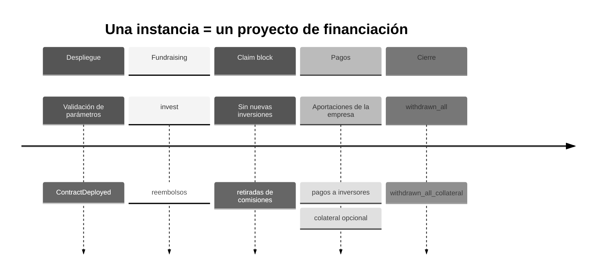

# Despliegue del contrato

Una instancia del contrato Equillar representa **un proyecto de financiación** con su configuración económica inmutable propia.

## Clonar el contrato equillar

Clona el contrato equillar usando git:

```bash
git clone https://github.com/icolomina/equillar-soroban.git
```

Después puedes entrar en la carpeta del proyecto y ejecutar los tests:

```bash
cd contracts/investment-income-based
cargo test
```

## Crear una identidad Stellar

Antes de desplegar, necesitas una identidad local que actúe como cuenta origen para los comandos de upload y deploy. `stellar keys generate` crea un nuevo keypair y lo guarda localmente bajo el alias dado (`admin` en este caso), mientras que `stellar keys fund` pide fondos de test (vía Friendbot) para activar esa cuenta en la red. Esto solo funciona en `testnet`; en `mainnet` la cuenta debe fondearse manualmente.

> Más información para instalar stellar-cli en la [documentación oficial de Stellar](https://developers.stellar.org/docs/tools/cli/install-cli)

```bash
stellar keys generate admin
stellar keys fund admin
```

## Compilar el contrato

Para compilar el contrato y generar el fichero wasm, utiliza el siguiente comando desde la carpeta `contracts/investment-income-based`:

```bash
stellar contract build
```

Al terminar el comando, encontrarás el fichero wasm bajo `target/wasm32v1-none/release/` (la ruta es relativa a la raíz del repo).

## Instalar el contrato

Antes de desplegar una instancia del contrato, debemos instalarlo en la red:

```bash
stellar contract upload \
  --wasm target/wasm32v1-none/release/<tu_fichero_wasm>.wasm \
  -s admin \
  --network testnet
```

Al terminar el comando, obtendrás el wasm hash del contrato que usarás después para desplegar una instancia del mismo.

> El flag `-s admin` (es de `--source-account`) le indica a la CLI que firme y envíe la transacción usando la identidad `admin` creada arriba.

## Desplegar el contrato

### Parámetros de despliegue del contrato

El método `__constructor` del contrato equillar debe recibir los siguientes parámetros:

| Parámetro | Tipo | Descripción |
|---|---|---|
| `admin_addr` | `Address` | Dirección del administrador del contrato (autoridad de máximo nivel). El admin controla la gestión de roles, pagos, retiradas, liquidación de colateral, cierre de emergencia y la pausa. Los flujos de entrada (`invest`) deben firmarse en cambio por direcciones que posean el rol `operator`. |
| `token_addr` | `Address` | Dirección del token (SEP-41) usado para todos los flujos financieros (depósitos, pagos, retornos). |
| `price_oracle` | `Address` | Dirección del contrato de oráculo de precios usado para valorar el token de colateral contra el token del contrato. Detallado en la sección [Colateral](./collateral.md). |
| `investment_params` | `InvestmentContractParams` | Struct con los parámetros económicos y temporales (ver siguiente sección). |

> **Nota sobre token_addr:** Equillar está diseñado en torno a stablecoins como token de settlement (`token_addr`). Los retornos pretenden reflejar el rendimiento del proyecto financiado subyacente, no el comportamiento de precio del token usado para mover el capital. Usar un activo volátil introduciría una fuente de riesgo totalmente ajena a la inversión en sí, minando la previsibilidad que los productos de financiación estructurada pretenden proporcionar. Como las stablecoins suelen estar reguladas y ancladas a una moneda fiat, mantienen esa volatilidad adicional fuera de la ecuación.

### Investment Params

| Campo | Tipo | Descripción |
|---|---|---|
| `i_rate` | `u32` | Tasa de interés/retorno ofrecido a los inversores, expresada en puntos básicos (p. ej. `500` = 5.00%). |
| `fundraising_days` | `u64` | Duración en días de la fase de fundraising. |
| `claim_block_days` | `u64` | Número de días durante los cuales los claims están bloqueados/no disponibles, contados tras cerrar el periodo de fundraising. |
| `goal` | `i128` | Objetivo de fundraising, expresado en unidades del token con sus decimales. Por ejemplo, para un token con 7 decimales, para expresar 1 unidad hay que enviar `1 × 10^7 = 10000000`. |
| `return_type` | `u32` | Esquema de pago de los retornos a inversores: `1` = ReverseLoan, `2` = Coupon. **ReverseLoan**: capital más ganancias se distribuyen juntos a lo largo de los meses configurados. **Coupon**: las ganancias se pagan primero a lo largo de los meses configurados, con el capital devuelto en el pago final (como un bono). Ver [Rondas de pago](./payment-rounds.md). |
| `return_months` | `u32` | Número de meses durante los cuales el retorno se distribuye a los inversores. |
| `min_per_investment` | `i128` | Importe mínimo permitido por inversión individual, expresado en unidades del token con sus decimales. |
| `cmr_upper_divisor` | `u32` | Divisor máximo aplicable al cálculo de la comisión. |
| `cmr_lower_divisor` | `u32` | Divisor mínimo aplicable al cálculo de la comisión. |
| `cmr_reductor` | `i128` | Número de unidades de token invertidas por las que el divisor aumenta en uno. |

Todos los parámetros del constructor se validan en el despliegue; un `i_rate`, `goal`, `return_months`, `min_per_investment` o cualquier parámetro `cmr_*` a cero se rechaza, igual que un `cmr_upper_divisor <= cmr_lower_divisor`. `return_type` debe ser `1` (ReverseLoan) o `2` (Coupon).

> **Nota sobre los parámetros `cmr_`:** estos tres parámetros configuran el **modelo de comisión decreciente**; se explican con un ejemplo trabajado en [Fundraising y posiciones](./fundraising-and-positions.md).

> **Nota sobre `claim_block_days`:** la longitud adecuada de esta ventana depende del integrador y, normalmente, de la naturaleza del proyecto financiado. El tipo de proyecto importa: financiar una flota de camiones (operativa rápida) difiere de financiar una planta solar (build-out más largo, más exposición a retrasos técnicos/burocráticos). El perfil de la empresa también importa: empresas de rápido crecimiento e intensivas en "quema" de caja (p. ej. startups) requerirían períodos de bloqueo más largos, reflejando su mayor perfil de riesgo, comparadas con negocios más establecidos.

### Ejemplo de despliegue con `stellar-cli`

Desde la versión de soroban que soporta constructores (protocolo ≥ 22), `stellar contract deploy` acepta argumentos del constructor tras `--`, de la misma forma que lo hace `stellar contract invoke`. Los tipos simples (`Address`, `String`, `u32`, `u64`) se pasan como texto plano; los structs custom se pasan como un objeto JSON cuyas claves coinciden con los nombres de los campos del struct.

```bash
stellar contract deploy \
  --wasm-hash <hash> \
  -s admin \
  --network testnet \
  -- \
  --admin_addr GBOWNERXXXXXXXXXXXXXXXXXXXXXXXXXXXXXXXXXXXXXXXXXXXXXXXXX \
  --token_addr CATOKENXXXXXXXXXXXXXXXXXXXXXXXXXXXXXXXXXXXXXXXXXXXXXXXXX \
  --price_oracle COAXXXXXXXXXXXXXXXXXXXXXXXXXXXXXXXXXXXXXXXXXXXXXXXXXXXX \
  --investment_params '{
    "i_rate": 500,
    "claim_block_days": 180,
    "fundraising_days": 60,
    "goal": "10000000000000",
    "return_type": 2,
    "return_months": 12,
    "min_per_investment": "1000000000",
    "cmr_upper_divisor": 60,
    "cmr_lower_divisor": 10,
    "cmr_reductor": "4000000000"
  }'
```

Los parámetros `goal`, `min_per_investment` y `cmr_reductor`: se escalan según los decimales del token (7 decimales en este ejemplo).

- **`goal`**: `1000000_0000000` → 1000000 de tokens.
- **`min_per_investment`**: `100_0000000` → una inversión mínima de 100 tokens.
- **`cmr_reductor`**: `400_0000000` → el divisor de comisión sube de uno en uno cada 400 tokens invertidos.

`goal`, `min_per_investment` y `cmr_reductor` son `i128`, así que deben pasarse como **strings** en el payload JSON (no como números planos).

> **Sobre el orden de las claves del struct:** la CLI empareja las claves del JSON con los campos del struct **por nombre**, por lo que el orden del objeto no es estrictamente necesario. En el ejemplo se listan en el mismo orden que la declaración de `InvestmentContractParams` por legibilidad, y es una buena práctica seguirlo para poder comparar contra el código de un vistazo.

Para obtener la dirección pública (`G...`) del parámetro `admin_addr` puedes derivarla de la identidad admin que creamos antes de generar el wasm del contrato:

```bash
stellar keys public-key admin
```

## Ciclo de vida de una instancia del contrato

Del despliegue a la finalización, una instancia pasa por cuatro fases temporales:



## Balance y Eventos

### Balance

Equillar sigue el estado financiero del contrato a través de un snapshot (`Balance`) basado en una **contabilidad de partida doble** con activos, pasivos y capital. La estructura se actualiza tras cada operación relevante (inversiones, pagos, retiradas, movimientos de colateral, reembolsos, etc.), y la ecuación contable se verifica tras cada actualización.

Se describe en detalle en [El modelo de Balance](./balance-model.md); aquí solo la introducimos, porque cada sección posterior muestra qué campos cambiaron y qué eventos se emitieron.

El balance puede consultarse en cualquier momento a través de la función read-only `get_contract_balance(env: Env, caller: Address)`. El consultante debe ser el `admin` o poseer alguno de los roles existentes (`operator`, `company` o `manager`).

```bash
stellar contract invoke \
  --id <YOUR_CONTRACT_ID> \
  -s admin \
  --network testnet \
  -- \
  get_contract_balance \
  --caller "G...."
```

### Eventos tras el despliegue

Justo después de un despliegue correcto, el contrato emite un evento `ContractDeployed`:

```rust
ContractDeployed {
    addr,                  // la dirección del contrato recién desplegado
    ts_fundraising_ends,   // timestamp de cierre del periodo de fundraising
    ts_payments_start,     // timestamp de inicio del calendario de pagos
}
```

Este evento permite a los integradores conocer las fechas clave (fijadas on-chain) sin tener que hacer polling del estado del contrato directamente.

En este punto, el balance está completamente inicializado a cero — sin inversiones, pagos, colateral ni retiradas:

```text
assets:
  payment_rigths                    = 0
  contract_earnings                 = 0
  managed_volume                    = 0
  managed_collateral                = 0
liabilities:
  payment_obligations               = 0
  return_collateral_obligations     = 0
equity:
  contract_commissions              = 0
```

### Leer eventos con stellar-cli

Los eventos del contrato pueden consultarse directamente con el comando `stellar events`, filtrando por ID de contrato y, opcionalmente, por topic:

```bash
stellar events \
  --id <CONTRACT_ID> \
  --network testnet \
  --start-ledger <LEDGER_NUMBER> \
  --type contract
```

Los eventos emitidos con `#[contractevent]` publican automáticamente el nombre del evento como parte de sus topics, junto con cualquier campo marcado explícitamente con `#[topic]`. Esto significa que una consulta puede reducirse a solo eventos `ContractDeployed` usando `--topic`:

```bash
stellar events \
  --id <CONTRACT_ID> \
  --network testnet \
  --start-ledger <LEDGER_NUMBER> \
  --topic "ContractDeployed,*" \
  --type contract
```
