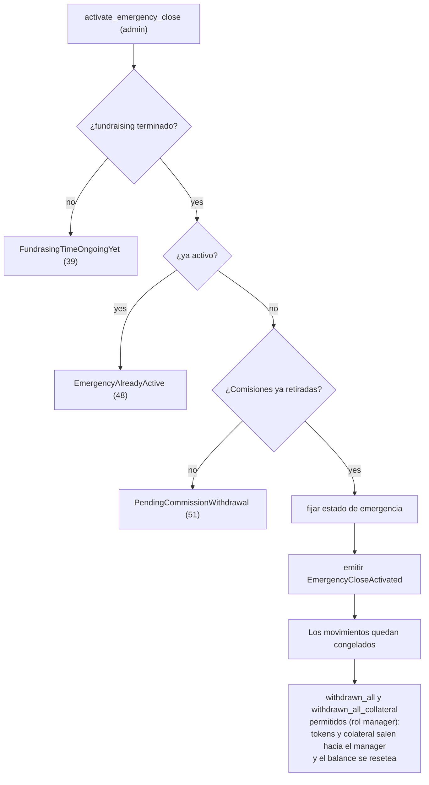

# Cierre de emergencia

El cierre de emergencia es la **compuerta terminal de cierre despues del periodo de financiación** del motor. Puede activarse cuando se espera que la empresa falle y no hay colateral para cubrir las posiciones. A partir de ese punto, la instancia se congela y sus fondos restantes solo pueden salir mediante:

- La funcion ([`withdrawn_all`](./withdrawals.md#el-barrido-final--withdrawn_all)) que retira todos los fondos restantes del contrato.
- La función ([`withdrawn_all_collateral`](./collateral.md#Barrido final del colateral — withdrawn_all_collateral)) que retira el colateral restante del contrato (si lo hubiese).
  
## Qué es y qué no es

> **No es** lo mismo que el [`refund_investor`](./refunds.md): los reembolsos devuelven importes depositados a los inversores mientras *el periodo de financiación esta vigente*, antes de que la empresa haya empezado a gastar los fondos recaudados. El cierre de emergencia es el camino posterior al fundraising.

> **Colateral frente a cierre de emergencia:** tienen propósitos distintos. El colateral actúa como salvaguarda por posición, es decir, una posición individual que no puede cubrirse con los fondos del contrato puede liquidarse inmediatamente con el colateral disponible, sin afectar al resto del proyecto. El cierre de emergencia es la compuerta terminal a nivel de proyecto, reservada para cuando esa salvaguarda ya no basta.

## Activar el cierre de emergencia

La activación la hace el admin mediante la función `activate_emergency_close()`:

```bash
stellar contract invoke \
  --id <YOUR_CONTRACT_ID> \
  -s admin \
  --network testnet \
  -- \
  activate_emergency_close
```

La activación se acepta solo cuando se cumplen **todas** las condiciones siguientes:

| Comprobación | Error si no se cumple |
|---|---|
| El periodo de fundraising ya ha terminado | `FundrasingTimeOngoingYet` (39) |
| El cierre de emergencia no estaba ya activado | `EmergencyAlreadyActive` (48) |
| Todas las comisiones pendientes ya están retiradas | `PendingCommissionWithdrawal` (51) |

## Qué cambia una vez activo el modo de emergencia

Una vez activado, *todos* los entrypoints que mueven capital: `invest`, `process_investor_payment`, `refund_investor`, `add_company_transfer`, `withdrawn` y `withdrawn_commissions` rechazan llamadas con `OperationNotAllowedInEmergency` (50). La liquidación de colateral (`pay_with_collateral`) y `add_collateral` quedan igualmente bloqueadas por sus guards de pausa/emergencia.

La activación de emergencia **no modifica el balance**. Activa la flag de estado de emergencia y los fondos permanecen en el contrato con los mismos campos del `Balance` que antes. Como vimos en [`withdrawn_all`](./withdrawals.md#el-barrido-final--withdrawn_all) y [`withdrawn_all_collateral`](./collateral.md#barrido-final-del-colateral--withdrawn_all_collateral), los fondos restantes (tokens y colateral) salen hacia una dirección `manager`. 

> **Nota importante**: `withdrawn_all` comprueba que el colateral se haya retirado previamente a retirar el resto de fondos y resetar el balance. Así pués, es necesario retirar el colateral como paso previo a `withdrawn_all`.



> **Nota operacional honesta:** el cierre de emergencia es una **congelación**, no un proceso automatizado de pagos. El contrato no tiene ningún entrypoint de pago de emergencia por inversor. Con la emergencia activa, `withdrawn_all` barre la totalidad del balance del token — incluidos los fondos aún debidos a los inversores si los hubiera — hacia la dirección `manager`, y `withdrawn_all_collateral` hace lo propio con el colateral restante; a partir de ahí es el integrador quien decide off-chain qué hacer con esos fondos. Los integradores deben tratar la liquidación de colateral y las rondas regulares como los caminos de settlement reales *antes* de recurrir al cierre de emergencia.

## Eventos tras activar el cierre de emergencia

**`EmergencyCloseActivated`**:

```rust
EmergencyCloseActivated {
    addr,   // la dirección del contrato
}
```

### Leer este evento con stellar-cli

```bash
stellar events \
  --id <YOUR_CONTRACT_ID> \
  --network testnet \
  --start-ledger <LEDGER_NUMBER> \
  --type contract \
  --topic "EmergencyCloseActivated,*"
```

## Cerrar una instancia de principio a fin

La secuencia completa de cierre que los integradores deben tener lista:

```text
1. Liquidar posiciones (recomendado antes de la activación): rondas de pago
   regulares y/o pay_with_collateral para reducir payment_obligations.
2. Retirar las comisiones pendientes (withdrawn_commissions) — necesario:
   equity contract_commissions debe estar a 0 para que la activación prospere.
3. activate_emergency_close (admin) — congela la instancia.
4. withdrawn_all_collateral (admin, receptor manager) — barre el colateral
   restante hacia el manager y mantiene el Balance reseteado.
   Instancia completamente cerrada.
5. withdrawn_all (admin, receptor manager) — barre cualquier balance de token
   restante (obligaciones liquidadas o pendientes) y resetea el Balance.
```

El paso 1 y la devolución de colateral (`return_collateral_to_company`) deben ocurrir **antes** de la activación si se quieren usar: después de ella los entrypoints de settlement quedan bloqueados y solo `withdrawn_all` y `withdrawn_all_collateral` siguen siendo posibles.
