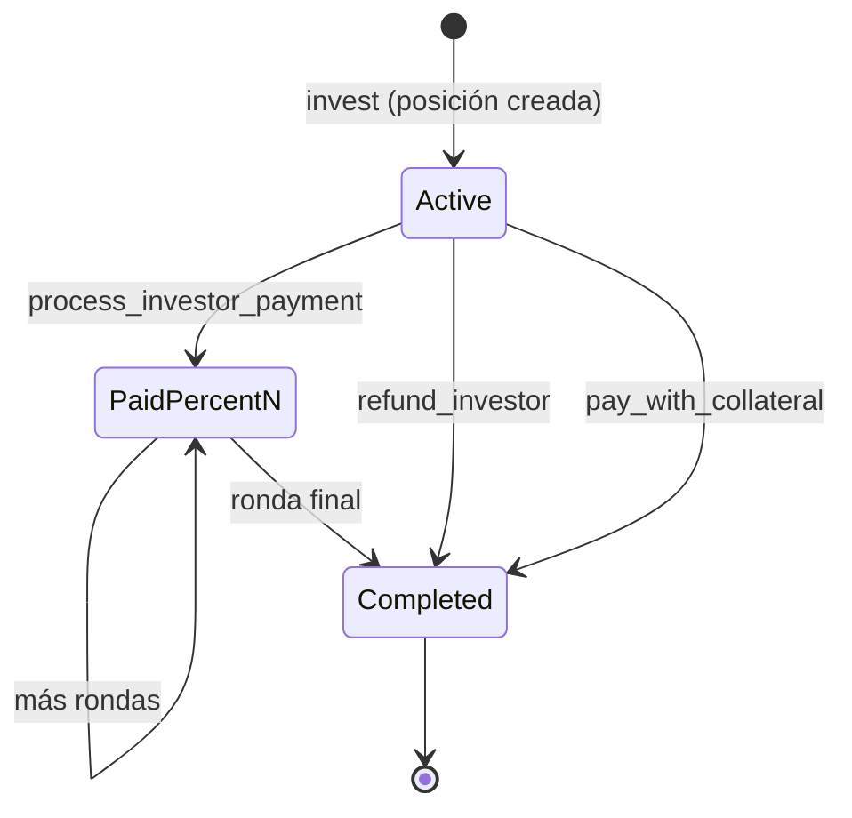
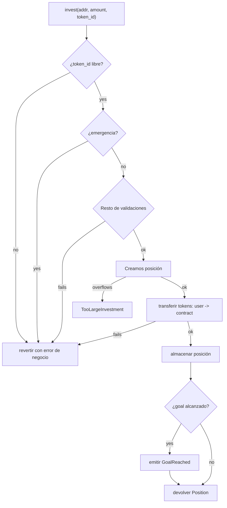

# Fundraising y posiciones

Durante la ventana de fundraising, Equillar acepta inversiones mediante la función `invest(investor, amount, position_id)`. Solo las direcciones `operator` pueden invocarla y, además, el contrato no debe estar pausado.

## Llamar a la función invest

```bash
stellar contract invoke \
  --id <YOUR_CONTRACT_ID> \
  -s operator \
  --network testnet \
  -- \
  invest \
  --addr "G....." \
  --amount "5000000000" \
  --token_id 1234
```

> El parámetro `addr` debe llevar la dirección de la identidad operator y `token_id` es el `position_id` aportado por el integrador.

Cada `position_id` identifica una posición que contiene (entre otros):

- cuánto se depositó realmente (neto de comisión)
- cuánto ganará el inversor
- cuánto se recibirá por ronda de pago

El `position_id` **no se genera on-chain sino off-chain por parte del integrador**. Equillar simplemente mapea cada `position_id` a la dirección que invirtió a través de él. Los pagos de esa posición se envían después a esa dirección. Como ejemplo, piensa en un `position_id` que no representa una única inversión sino un grupo colectivo de inversores: Equillar envía los pagos correspondientes a la dirección mapeada, y el integrador los distribuye entre los distintos inversores.

## Restricciones del fundraising

Una inversión se acepta solo si se cumplen **todas** las siguientes condiciones (comprobadas en este orden):

| Comprobación | Error si no se cumple |
|---|---|
| No existe aún una posición asociada al identificador recibido | `PositionIdAlreadyExists` (53) |
| El contrato no está en estado de emergencia | `OperationNotAllowedInEmergency` (50) |
| Lo recaudado hasta ahora (balance del token del contrato) sigue por debajo de `goal` | `GoalReached` (30) |
| El monto invertido debe ser mayor o igual al mínimo por inversión | `AmountLessThanMinimum` (5) |
| La dirección inversora tiene balance suficiente | `AddressInsufficientBalance` (1) |
| La fecha de inversión está dentro de la ventana de fundraising | `FundrasingTimeExceeded` (40) |

Además, la matemática de asignación debe tener éxito: los importes tan grandes que desbordan la aritmética de punto fijo (WAD) usada internamente se rechazan con `TooLargeInvestment` (61) — ver [El límite de los depósitos muy grandes](#el-límite-de-los-depósitos-muy-grandes).

## Asignación de la inversión

El importe bruto de la inversión se divide en dos segmentos:

1. **importe de proyecto** (depositado neto)
2. **importe de comisión**

La comisión es dinámica y depende del tamaño de la inversión y de la lógica de tasas configurada. Inversiones mayores aumentan el tramo del denominador y reducen la tasa de comisión efectiva. El integrador configura la tasa a la que se reducen las comisiones en el momento del despliegue mediante:

- `cmr_upper_divisor`
- `cmr_lower_divisor`
- `cmr_reductor`

### Paso 1 — tramo del denominador de la comisión

A nivel de contrato el denominador sigue esta regla:

```text
denominator = cmr_lower_divisor + (amount / cmr_reductor)    // división entera, truncada
if denominator > cmr_upper_divisor: denominator = cmr_upper_divisor
```

Es decir, el tramo **empieza en `cmr_lower_divisor`**, aumenta en **1** por cada `cmr_reductor` unidades de token adicionales invertidas (truncamiento entero) y está **limitado a `cmr_upper_divisor`**.

Ejemplo con `cmr_reductor = 400_0000000` (400 tokens, 7 decimales):

```text
0 a 399.999... tokens invertidos    -> denominador 10  (cmr_lower_divisor)
400 a 799.999... tokens invertidos  -> denominador 11
800 a 1199.999... tokens invertidos -> denominador 12
...
```

Este ratio es lo que hace que el modelo de comisión sea **decreciente** en lugar de plano: cada 400 tokens adicionales invertidos bajan la tasa efectiva, hasta el tope.

### Paso 2 — comisión y retornos

Resuelto el tramo, la asignación es:

```text
commission_rate = i_rate / (denominator × 10_000)
commission      = amount × commission_rate          (truncada a unidades del token)
deposited       = amount - commission

return_rate     = i_rate / 10_000
returns         = deposited × return_rate           (truncada a unidades del token)

total           = deposited + returns               (lo que tiene derecho a recibir el inversor)
```

Observa que los retornos se calculan sobre el importe **deposited** (neto de comisión), no sobre el importe bruto.

## Ejemplo a escala del token

El siguiente ejemplo usa los parámetros del ejemplo de despliegue de [Despliegue del contrato](./deploying-the-contract.md#ejemplo-de-despliegue-con-stellar-cli):

- importe de inversión: `500` tokens = `5_000000000` unidades raw
- `i_rate = 500` (5%)
- `return_months = 12`
- `cmr_upper_divisor = 60`, `cmr_lower_divisor = 10`, `cmr_reductor = 4_000000000` (400 tokens)

### Tramo

```text
step          = 5_000000000 / 4_000000000 = 1   (división entera)
denominator   = 10 + 1 = 11                    (por debajo del tope de 60)
```

### Comisión

```text
commission_rate = 500 / (11 × 10_000) = 500 / 110_000 ≈ 0.45%
commission_raw  = floor(5_000000000 × 500 / 110_000) = 22_727272   (2.2727272 tokens)
deposited       = 5_000000000 - 22_727272 = 4_977272728            (497.7272728 tokens)
```

### Retornos y total

```text
returns = floor(4_977272728 × 5%) = 248_863636                     (24.8863636 tokens)
total   = 4_977272728 + 248_863636 = 5_226136364                   (522.6136364 tokens)
regular_payment (Coupon) = 248_863636 / 12 = 20_738636             (2.0738636 tokens por ronda)
```

> **¿Por qué dividimos entre `10_000`?** El `i_rate` está expresado en **basis points** (puntos básicos): un punto básico es la centésima parte del 1%, es decir `1/10_000 = 0.0001`. El `500` del ejemplo se convierte en fracción en dos pasos de división por 100:
>
> ```text
> 500 ÷ 100 = 5      → "5" como número de porcentaje (5.00)
> 5   ÷ 100 = 0.05   → fracción real del 5%
> ```
>
> Dos divisiones de 100 equivalen a una de `10_000`. Como además la tasa de **comisión** se divide por el tramo del denominador (11 en el ejemplo), el contrato junta todo en un único denominador: `i_rate / (tramo × 10_000)` y lo resuelve en una sola división.

## El límite de los depósitos muy grandes

Internamente, la matemática de asignación se realiza en **aritmética de punto fijo WAD** (una escala fija 10^18 mantenida por la librería de matemáticas de OpenZeppelin) y **operaciones checked**. Los depósitos se convierten primero a la escala interna y luego se validan de manera que ninguna multiplicación intermedia pueda desbordar:

```text
importe máximo representable ≈ 10^27 unidades raw para un token de 7 decimales
                              (i128::MAX / 10^(18 - decimals))
```

Los depósitos fuera de ese rango no pueden participar con seguridad en la asignación y se rechazan **limpiamente** con `TooLargeInvestment` (61): la posición no se crea, **no se realiza ninguna transferencia de tokens**, y el balance queda exactamente como estaba. No hay trap ni panic por depósitos sobredimensionados desde el lado del inversor.

## Máquina de estados de la posición

Una posición pasa por muy pocos estados:



A una posicion completada no se le aplican más pagos, reembolsos ni liquidaciones de colateral.

## El flujo de inversión



> **Nota de ordenación:** la asignación se calcula **antes** de la transferencia de tokens. Si la asignación no puede representarse (depósito que desborda), la transferencia nunca se realiza. El balance del inversor nunca se toca en un rechazo inicial.

## Eventos y balance tras una nueva inversión

Cuando se acepta un nuevo depósito, el contrato actualiza el balance mediante `recalculate_from_position`:

- `assets.contract_earnings += commission`
- `assets.managed_volume += total`
- `equity.contract_commissions += commission`
- `liabilities.payment_obligations += total`

(la ecuación se verifica antes de persistir — ver [El modelo de Balance](./balance-model.md))

Tres eventos forman parte de este flujo:

**1. `BalanceUpdated`** — el snapshot de balance actualizado:

```rust
BalanceUpdated {
    assets: BalanceAsset { payment_rigths, contract_earnings, managed_volume, managed_collateral },
    liabilities: BalanceLiabilities { payment_obligations, return_collateral_obligations },
    equity: BalanceEquity { contract_commissions },
}
```

**2. `InvestmentReceived`** — detalles de la inversión en sí:

```rust
InvestmentReceived {
    addr,           // la dirección del contrato
    deposited,      // importe neto del deposito puesto bajo gestión (amount - commission)
    capital_gains,  // el rendimiento que recibirá el inversor
}
```

**3. `GoalReached`** — si el depósito provoca que se alcance el objetivo de fundraising (comprobado contra el balance del token del contrato tras la transferencia):

```rust
GoalReached {
    addr,             // la dirección del contrato
    total_received,   // el balance del token del contrato en ese momento
    goal,             // el objetivo de fundraising configurado en el despliegue
}
```

### Leer estos eventos con stellar-cli

```bash
stellar events \
  --id <CONTRACT_ID> \
  --network testnet \
  --start-ledger <LEDGER_NUMBER> \
  --type contract \
  --topic "InvestmentReceived,*"
```

```bash
stellar events \
  --id <CONTRACT_ID> \
  --network testnet \
  --start-ledger <LEDGER_NUMBER> \
  --type contract \
  --topic "GoalReached,*"
```
