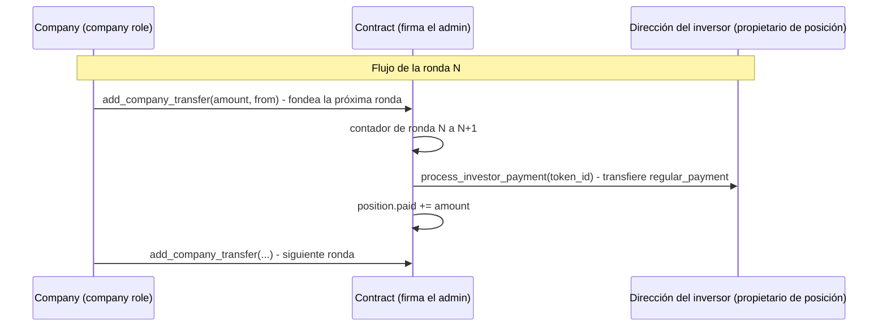

# Rondas de pago

Tras terminar la ventana de tiempo de bloqueo (el periodo posterior al fundraising durante la cual la empresa esta ejecutando la operativa del proyecto), el proyecto entra en la fase de pagos regulares. Equillar **no** obliga a los integradores a ejecutar los pagos dentro del contrato ya que existe un modo en el que las posiciones se actualizan on-chain pero las transferencias de tokens se hacen por otras vías. Veamos ambos modos.

## Rondas de pago con transferencias en el contrato

Estas rondas se llevan a cabo en dos pasos:

1. La transferencia de la empresa (`add_company_transfer`)
2. Los pagos a cada posición (`process_investor_payment`)



### La transferencia de la empresa

En este primer paso, la empresa (desde una dirección con el rol `company`) transfiere fondos suficientes para cubrir los pagos correspondientes de la próxima ronda, mediante `add_company_transfer(amount, from)`:

```bash
stellar contract invoke \
  --id <YOUR_CONTRACT_ID> \
  -s admin \
  --network testnet \
  -- \
  add_company_transfer \
  --amount "21000000" \
  --from "G....."
```

Las transferencias de empresa solo se permiten si se cumplen todas las condiciones siguientes:

| Comprobación | Error si no se cumple |
|---|---|
| El contrato no está pausado | guard de pausa |
| No hay emergencia activa | `OperationNotAllowedInEmergency` (50) |
| Fecha actual dentro de la ventana de ronda | `NextPaymentCannotBeScheduledYet` (43) |
| Fondos suficientes para cubrir el pago | `ContractReserveInsufficientBalance` (2) |
| La dirección `from` tiene balance suficiente | `OwnerInsufficientBalance` (47) |


Tras la transferencia de la empresa, los pagos no se ejecutan automáticamente. Los fondos permanecen en poder del contrato hasta que se llama a la función de pago de cada posición. El número de ronda se **incrementa** para que el pago actual se marque como finalizado: si el número de ronda no se incrementara, la función de pago intentaría pagar una ronda ya pagada y fallaría.

### La función de pago

Los pagos a inversores se realizan mediante `process_investor_payment(token_id)`:

```bash
stellar contract invoke \
  --id <YOUR_CONTRACT_ID> \
  -s admin \
  --network testnet \
  -- \
  process_investor_payment \
  --token_id 1234
```

Los pagos se permiten solo si se cumplen todas las condiciones siguientes:

| Comprobación | Error si no se cumple |
|---|---|
| El contrato no está pausado / no hay emergencia activa | guard de pausa / (50) |
| La posición existe | `AddressHasNotInvested` (14) |
| La posición no está completada | `PositionCompleted` (38) |
| La ronda no se ha pagado aun para la posición | `PaymentAlreadyProcessedForThisPeriod` (42) |
| Existen suficientes fondos para cubrir el pago | `ContractReserveInsufficientBalance` (2) |

Tras ejecutarse la función, el pago se envía al propietario de la posición: la dirección `operator` que llamó a `invest` con este `token_id`. `process_investor_payment` se llama individualmente para cada `token_id` que invirtió en el proyecto. Esto resulta en muchas llamadas al contrato, pero a cambio da a los integradores flexibilidad para distribuir los pagos de acuerdo a sus necesidades.

> **Disciplina por posición y por ronda (modo con transferencias).** La comprobación de ronda es estricta *por posición*: una posición saltada en la ronda N no se puede pagar después ya que en N+1 su contador interno ya no coincide. No pagar una posición dentro de su ronda bloquea esa posición de forma permanente (error 42), así que es necesario integrar un scheduler fiable que pague todas las posiciones en todas las rondas antes de aportar los fondos de la siguiente ronda vía `add_company_transfer`. Esto aplica cuando las liquidaciones del contrato están **habilitadas** (por defecto); el modo sin transferencias omite esta verificación (ver más abajo).

### ¿Cuánto se paga en cada ronda?

El importe por ronda depende del `return_type`:

- **Coupon**: paga `regular_payment` = `returns / return_months` por ronda. En la **ronda final** (`payments_transferred == return_months`) se paga también el capital aportado (deposited - la comisión descontada).
- **ReverseLoan**: paga `regular_payment` = `total / return_months` por ronda.

Continuación del [ejemplo de escala token](./fundraising-and-positions.md#ejemplo-a-escala-del-token) (Coupon, 12 meses, posición con `total = 5_226136364`):

```text
rondas 1..11:  única cantidad = 20_738636 cada una  (2.0738636 tokens)
ronda 12 (última): paga también depósito neto = 20_738640 + 4_977272728 = 4_998_011_368 (499.8011368 tokens)

total recibido por el inversor = 499.8011368 + (11 * 20_738636) = 522.6136364 
```

El tipo de pago `Coupon` se comporta como un bono: interés primero, capital devuelto en el último pago. ReverseLoan en cambio amortiza `total/return_months` cada mes.

## Rondas de pago sin transferencias en el contrato

Equillar no obliga a los integradores a transferir los pagos dentro del contrato. Este modo se configura durante la ventana de claim block (ver más abajo) y cambia lo que hace `process_investor_payment`: la posición se actualiza on-chain (contadores de ronda, `paid`, completion) pero **no se realiza ninguna transferencia de tokens** y no se aplica ninguna comprobación de reserva. El integrador envía el pago por un método alternativo (p. ej. ordenamiento off-chain) y el contrato simplemente lo registra.

### Habilitar / deshabilitar las liquidaciones de inversión

El contrato expone:

- **`enable_investment_liquidations`** (admin)
- **`disable_investment_liquidations`** (admin)
- **`check_investment_liquidations`** (admin o cualquier rol; read-only, permitido incluso en pausa)

```bash
stellar contract invoke \
  --id <YOUR_CONTRACT_ID> \
  -s admin \
  --network testnet \
  -- \
  disable_investment_liquidations
```

Tanto `enable_*` como `disable_*` solo se aceptan durante la ventana de claim block — estrictamente tras el final del fundraising y estrictamente antes del inicio de los pagos (`LiquidationPaymentsOutOfPeriod`, 54).

> **El modo por defecto es con transferencias**: si nunca se llamó a estas funciones, se asume que las liquidaciones de inversión están **habilitadas**, es decir, el comportamiento por defecto es que el propio contrato realice las transferencias de tokens.

### Comportamiento de las rondas en el modo sin transferencias

Con las liquidaciones **deshabilitadas**, la validación estricta de ronda/reserva se omite: `process_investor_payment` no comprueba ni el contador de ronda ni la reserva, y no realiza ninguna transferencia de tokens — solo actualiza la posición on-chain (`payments_transferred`, `paid`, completion en la ronda final). En consecuencia:

- `add_company_transfer` **no es necesaria** para avanzar rondas en este modo (la comprobación de ronda simplemente no se aplica); llámala solo si aún quieres el asiento contable de las aportaciones de la empresa.
- Llama a `process_investor_payment` cada vez que se haya enviado un pago off-contract para una posición; saltarse rondas no penaliza, ya que no hay reserva del contrato implicada.

Todo se mantiene consistente en el `Balance`: cada llamada sigue bajando `managed_volume` y `payment_obligations`, de manera que la ecuación de partida doble sigue trackeando la realidad que el integrador liquida fuera del contrato.

```bash
stellar contract invoke \
  --id <YOUR_CONTRACT_ID> \
  -s admin \
  --network testnet \
  -- \
  process_investor_payment \
  --token_id 1234
```

## Eventos y balance tras una transferencia de empresa

Cuando la empresa transfiere fondos para la próxima ronda mediante `add_company_transfer`, el balance se actualiza vía `recalculate_from_company_contribution`:

- `assets.payment_rigths -= amount` (disminuyen las obligaciones de pago de la empresa con el contrato)
- `assets.managed_volume += amount` (aumenta el volumen negociado del contrato)

(el total neto de activos permanece inalterado — los tokens físicamente llegaron y se reclassifican como volumen gestionado; ver [El modelo de Balance](./balance-model.md#activos--lo-que-el-contrato-gestiona))

Esta actualización se publica a través del evento estándar `BalanceUpdated`. Además, el contrato emite un evento dedicado con los detalles de la transferencia:

**`CompanyTransferReceived`**:

```rust
CompanyTransferReceived {
    addr,             // la dirección del contrato
    total_received,   // el importe total transferido por la empresa
}
```

### Leer este evento con stellar-cli

```bash
stellar events \
  --id <CONTRACT_ID> \
  --network testnet \
  --start-ledger <LEDGER_NUMBER> \
  --type contract \
  --topic "CompanyTransferReceived,*"
```

## Eventos y balance tras un pago regular a un inversor

Cuando se procesa una ronda de pago para un inversor mediante `process_investor_payment`, el balance se actualiza vía `recalculate_from_payment_to_investor`:

- `assets.managed_volume -= amount` (el volumen negociado disminuye)
- `liabilities.payment_obligations -= amount` (Las obligaciones de pago con el inversor también disminuyen en el lado del pasivo)

Esta actualización se publica a través del evento estándar `BalanceUpdated`. Además, el contrato emite un evento dedicado con los detalles del pago:

**`PaymentSent`**:

```rust
PaymentSent {
    addr,         // la dirección del contrato
    total_sent,   // el importe total enviado al inversor
}
```

### Leer este evento con stellar-cli

```bash
stellar events \
  --id <CONTRACT_ID> \
  --network testnet \
  --start-ledger <LEDGER_NUMBER> \
  --type contract \
  --topic "PaymentSent,*"
```
