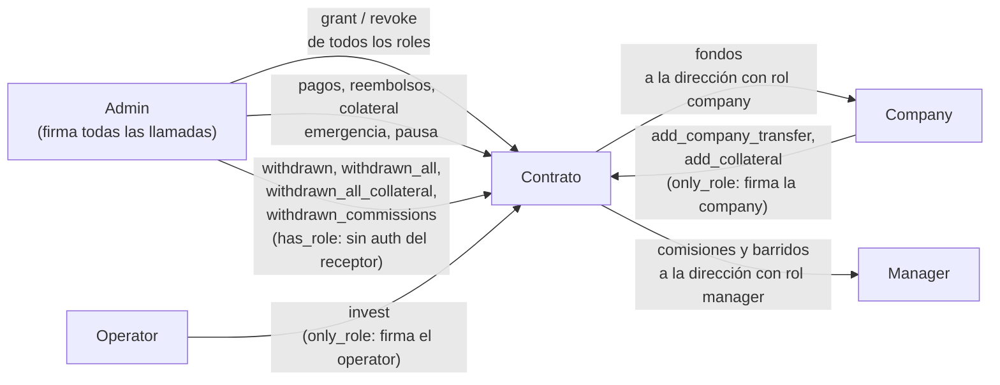

# Configuración y revocación de roles

Tras el despliegue, el admin puede empezar a configurar los actores que tendrán permiso para operar en el proyecto (instancia del contrato). Equillar define un conjunto de roles, y toda dirección involucrada en los flujos de entrada/salida de capital del contrato debe tener asignado uno de estos roles antes de poder interactuar con ellos.

## Roles

| Rol | Propósito | Modelo de firma |
|---|---|---|
| **Admin** | Autoridad de máximo nivel sobre la gestión de roles, procesado de pagos, acciones de tesorería, liquidación de colateral, cierre de emergencia y pausa/reanudación del contrato. Se establece en el deploy y se puede transferir en dos pasos (`transfer_admin_role` + `accept_admin_transfer_role`). | Firma las llamadas privilegiadas. |
| **Operator** | Crea nuevas inversiones (`invest`) para direcciones de inversores. Particularmente útil para actores regulados que comparten una única dirección entre muchos usuarios finales. | Firma las llamadas `invest`. |
| **Company** | Designa la dirección autorizada a fondear rondas de pago (`add_company_transfer`), recibir fondos de proyecto (`withdrawn`) y depositar colateral (`add_collateral`). | Firma el admin pero la dirección destino debe tener asignado este rol. |
| **Manager** | Designa la dirección autorizada a recibir las comisiones del integrador (`withdrawn_commissions`) y las operaciones finales de barrido (`withdrawn_all`, `withdrawn_all_collateral`). | Firma el admin pero la dirección destino debe tener asignado este rol. |

Cardinalidad de los roles: **`operator` es multi-holder** (muchas direcciones pueden poseerlo simultáneamente), mientras que **`company` y `manager` son single-holder** — el contrato impone un único miembro por rol, con errores explícitos si no se cumple la regla:

| Error | Código | Significado |
|---|---|---|
| `AddressAlreadyHoldsRole` | 16 | La dirección a la que se hace grant ya posee ese rol. |
| `AddressRoleAlreadyExists` | 17 | Hacer grant de `company` o `manager` mientras el rol ya está asignado. |

## Flujos de grant y revoke

El admin puede usar:

- `grant_operator` / `revoke_operator`
- `grant_company` / `revoke_company`
- `grant_manager` / `revoke_manager`

La revocación de un rol surte efecto inmediatamente a nivel de contrato. Por ejemplo, un operador revocado ya no puede crear nuevas inversiones aunque las posiciones que creó antes siguen existiendo y recibiendo pagos.

Todos los grant/revoke son solo-admin y están bloqueados mientras el contrato está pausado.

Los siguientes comandos muestran cómo hacer grant y revoke de un operador llamando a las funciones correspondientes vía stellar-cli:

### Crear una nueva identidad para el operador

```bash
stellar keys generate operator
stellar keys fund operator
```

### Obtener la clave pública del operador

```bash
stellar keys public-key operator
```

### Grant del rol operator llamando a la función correspondiente

```bash
stellar contract invoke \
  --id <YOUR_CONTRACT_ID> \
  -s admin \
  --network testnet \
  -- \
  grant_operator \
  --operator <LA_DIRECCION_DEL_OPERADOR>
```

El valor `<LA_DIRECCION_DEL_OPERADOR>` es la dirección devuelta por el comando `stellar keys public-key operator` de arriba.

### Revoke del rol operator llamando a la función correspondiente

```bash
stellar contract invoke \
  --id <YOUR_CONTRACT_ID> \
  -s admin \
  --network testnet \
  -- \
  revoke_operator \
  --operator <LA_DIRECCION_DEL_OPERADOR>
```

## Cómo se mapean los roles al ciclo de vida

La clave para leer el diagrama: **el admin firma todas las operaciones privilegiadas**. Las direcciones `company` y `manager` no inician llamadas sino que cuando actúan como **receptoras** de fondos (`withdrawn`, `withdrawn_commissions`, `withdrawn_all`, `withdrawn_all_collateral`). El contrato solo comprueba que tengan el rol asignado, vía la macro `has_role`, que **no** exige autorización del receptor (ver [AccessControl de OpenZeppelin](https://docs.openzeppelin.com/stellar-contracts/access/access-control#role-checking-macros)). En cambio, cuando una dirección con rol actúa como **origen** (`invest` del operator, `add_company_transfer` y `add_collateral` de la company) el macro `only_role` sí exige su autorización (`require_auth`).



> **Nota:** hacer grant y revoke de los roles company y manager sigue exactamente el mismo proceso CLI descrito arriba, usando `grant_company` / `revoke_company` y `grant_manager` / `revoke_manager`.
